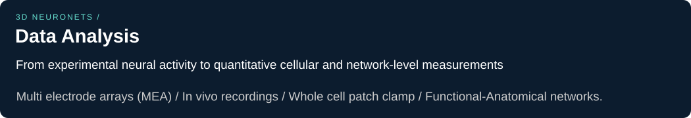

[← Portfolio](../README.md)

| Capability | Scope |
|---|---|
| [Multi-Electrode Arrays (MEA)](multi-electrode-arrays/README.md) | From multichannel recordings to neural population dynamics |
| [Whole-Cell Patch Clamp](whole-cell-patch-clamp/README.md) | Quantify intrinsic and synaptic electrophysiology |
| [In Vivo Recordings](in-vivo-recordings/README.md) | Characterize neural activity in living systems |
| [Functional & Anatomical Networks](functional-anatomical-networks/README.md) | From spike trains and microscopy to circuit architecture |

## Human cortical reconstruction

[Microscopy & anatomical connectivity](functional-anatomical-networks/README.md) → [Human cortical simulation](../Data-Driven-Models/human-cortical-model/README.md)

[Website](https://3dneuronets.github.io/) · [Publications](https://3dneuronets.github.io/publications.html)
