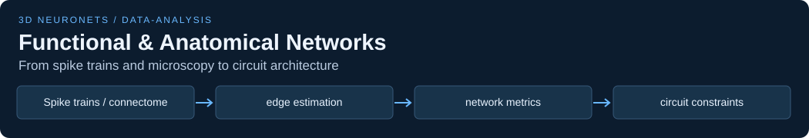
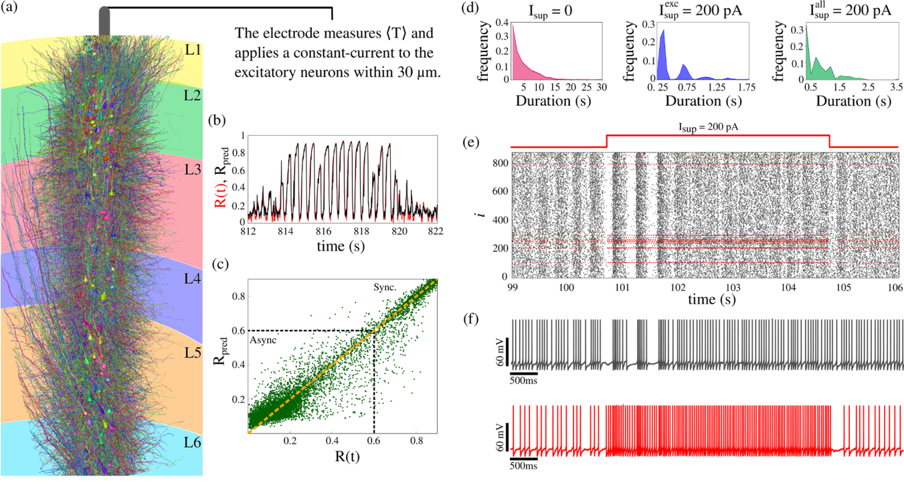
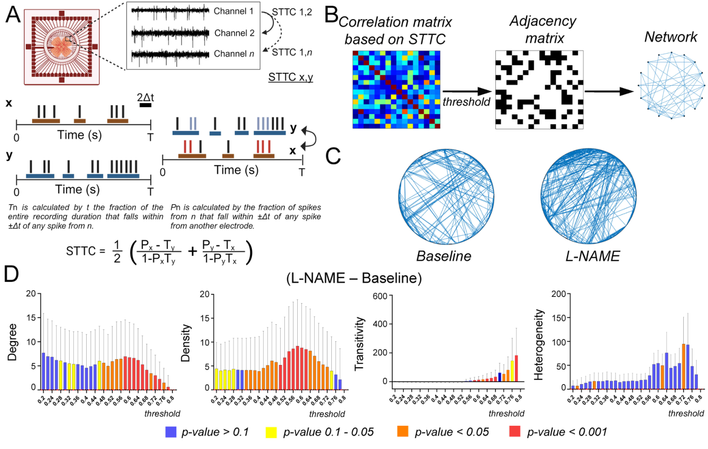

[← Portfolio](../../README.md) · [Data Analysis](../README.md)

**From neuronal activity and anatomical reconstructions to quantitative brain connectivity.**

We develop customized computational approaches to reconstruct, analyze, and characterize neuronal networks using electrophysiological recordings and anatomical connectivity datasets. By combining functional connectivity estimation, graph-theoretical analysis, spatial reconstruction, and connectomics, our workflows reveal how neurons interact and how their organization influences collective network behavior.

Our solutions enable researchers to investigate network architecture, identify changes in connectivity across experimental conditions, and extract biologically informed circuit properties for computational modeling. From multielectrode recordings to nanoscale human cortical reconstructions, we provide adaptable analytical frameworks for investigating neural connectivity across different biological scales.

## Key Capabilities

Our neural network analysis solutions combine electrophysiological data processing, anatomical reconstruction, statistical connectivity estimation, and graph-theoretical methods. We develop flexible workflows to quantify neuronal interactions, characterize network organization, and extract connectivity information for experimental interpretation and computational modeling.

| Capability | What We Offer |
|---|---|
| **Functional Connectivity Analysis** | Estimation of statistical relationships between neuronal activity patterns using spike-train correlations, spike-time tiling coefficients (STTC), and related connectivity measures. |
| **Directed Network Interaction Analysis** | Investigation of directional statistical dependencies using transfer entropy, temporal relationships, and appropriate significance testing. |
| **Anatomical Connectomics Processing** | Processing and integration of reconstructed neuronal positions, cell classifications, synaptic connections, and connectivity matrices from anatomical datasets. |
| **Graph-Theoretical Network Characterization** | Quantitative analysis of network degree, density, clustering, centrality, transitivity, modularity, and other topological properties. |
| **Spatial & Cell-Type-Specific Connectivity** | Characterization of spatial connectivity patterns, distance-dependent connection probabilities, and interactions between neuronal populations. |
| **Comparative Network Analysis** | Evaluation of changes in functional or anatomical network organization across experimental conditions, developmental stages, and biological groups. |
| **Statistical Validation & Network Robustness** | Assessment of connectivity estimates using surrogate data, significance testing, threshold exploration, and comparisons with appropriate reference networks. |
| **Connectomics-to-Model Integration** | Organization and transformation of anatomical connectivity information into quantitative constraints suitable for constructing data-driven neuronal network models. |

**Applications:** Functional connectivity · Anatomical connectomics · Graph theory · Neural circuit reconstruction · Network topology · Spatial connectivity · Experimental condition comparison · Data-driven modeling
## Research Applications

### Human Cortical Connectomics and Data-Driven Network Reconstruction

Human cortical connectivity data from the H01 nanoscale reconstruction were integrated into computational neuronal networks to investigate how anatomical organization influences collective brain activity. By extracting spatially organized neuronal populations and preserving experimentally reconstructed synaptic connections, the study demonstrated how complex human connectomic datasets can be transformed into functional network representations.

This research highlights our expertise in **human connectomics processing, anatomical connectivity analysis, and the integration of structural datasets into computational models**, providing a foundation for investigating cortical organization and developing customized, biologically informed neural circuits.

*Human cortical connectomics integrated into computational network modeling. Anatomically reconstructed connectivity from the H01 human temporal cortex dataset provides the structural foundation for simulations of neuronal population activity. Network representations, synchronization analysis, and computational predictions demonstrate how nanoscale connectomic measurements can be incorporated into functional models of human cortical dynamics.. Source: [Souza et al. (2026), Figure 8](https://doi.org/10.1038/s41598-026-44063-w); [CC BY 4.0](https://creativecommons.org/licenses/by/4.0/).*

**Research reference:** Souza et al. (2026). *Neuronal silence as a predictive biomarker and target for epileptic seizures suppression.* Scientific Reports. [DOI](https://doi.org/10.1038/s41598-026-44063-w).

---

### Functional Connectivity Reconstruction from High-Density Neural Recordings

Advanced computational analysis of high-density multielectrode array recordings was used to reconstruct functional neuronal networks and characterize their organization during retinal development. By combining spike detection, spike-time correlation analysis, connectivity matrix reconstruction, and graph-theoretical measurements, the study quantified functional interactions across large neuronal populations.

Comparative network analysis revealed changes in connectivity organization following pharmacological manipulation, demonstrating how our computational approaches can **identify network alterations, quantify functional connectivity, and extract meaningful information from complex electrophysiological datasets**.

*Spike trains, STTC correlation, adjacency construction and network statistics. Source: [Walter et al. (2026), Figure 4, article-in-press version](https://doi.org/10.1038/s41420-026-03228-2); [CC BY 4.0](https://creativecommons.org/licenses/by/4.0/).*

**Research reference:** Walter et al. (2026). *Nitric oxide refines retinal circuit architecture independently of retinal wave dynamics.* Cell Death Discovery. [DOI](https://doi.org/10.1038/s41420-026-03228-2).

---

## Software & implementations

| Implementation | Scope |
|---|---|
| [Transfer-entropy and graph analysis notebooks](../multi-electrode-arrays/hd-mea-aging-workflows/README.md) | Directed TE, circular-shift surrogates, FDR and graph metrics. No direct causal or anatomical identification is claimed. |
| [Neuronal silence simulation and prediction](../../Data-Driven-Models/model-to-study-epilepsy/neuronal-silence/README.md) | Related implementation. |

The bundled code is research-stage material supplied for review. Confirm release rights and environment compatibility before publishing or reuse. No end-to-end reproduction is claimed.

## Additional scientific context

- Shapson-Coe et al. (2024). *A petavoxel fragment of human cerebral cortex reconstructed at nanoscale resolution.* Science. [DOI](https://doi.org/10.1126/science.adk4858).

## Related capabilities

[Human Cortical Model](../../Data-Driven-Models/human-cortical-model/README.md) · [Multi-Electrode Arrays (MEA)](../multi-electrode-arrays/README.md) · [Models to Study Epilepsy](../../Data-Driven-Models/model-to-study-epilepsy/README.md) · [Rat Thalamocortical Model](../../Data-Driven-Models/rat-thalamocortical-model/README.md)

## Explore the Connectivity of Your Neural Data

**Have multielectrode recordings, anatomical reconstructions, or connectivity datasets that require advanced computational analysis?**

3D NeuroNets develops customized solutions to reconstruct neural interactions, quantify network architecture, compare biological conditions, and transform experimental connectivity information into meaningful computational representations.

[Explore 3D NeuroNets](https://3dneuronets.github.io/) · [Contact Us](https://3dneuronets.github.io/#contact)

*Research applications are collaborative academic contributions and demonstrate expertise; they are not represented as completed commercial contracts.*
