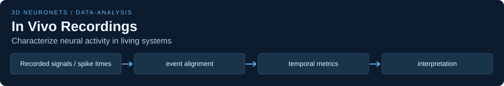
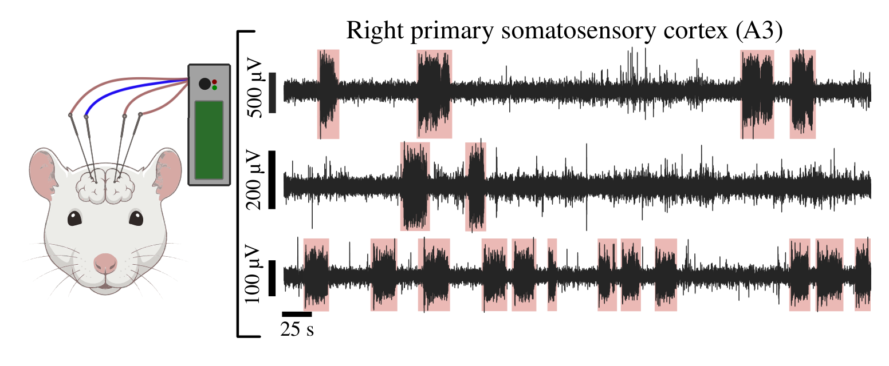
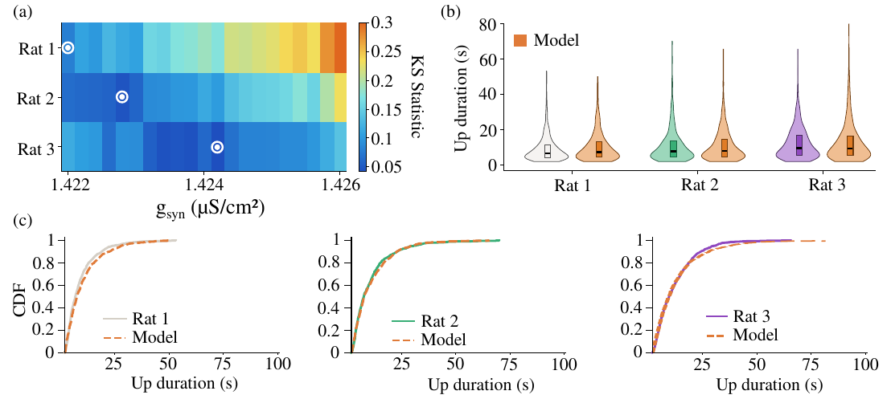
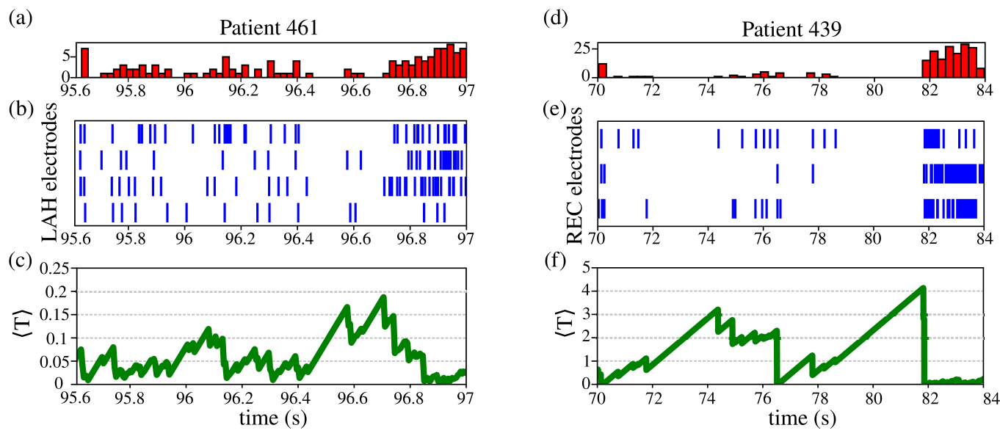

[← Portfolio](../../README.md) · [Data Analysis](../README.md)

**From complex brain recordings to quantitative insights into neural activity and dynamics.**

We develop customized computational approaches for processing, analyzing, and interpreting electrophysiological signals recorded from living neural systems. Combining signal processing, spike-train analysis, nonlinear dynamics, and statistical methods, our workflows enable the characterization of neuronal activity, brain oscillations, and transitions between physiological and pathological states.

Our solutions support the analysis of long-duration recordings, the detection of relevant neural events, the investigation of population dynamics, and the identification of activity patterns associated with behavioral or experimental conditions. By integrating advanced analytical methods with computational neuroscience, we help researchers extract meaningful information from complex in vivo electrophysiological datasets.

## Key Capabilities

Our in vivo electrophysiological analysis solutions combine advanced signal processing, neuronal activity characterization, and quantitative time-series analysis. We develop adaptable computational workflows to extract meaningful physiological features, identify neural events, and investigate the temporal organization of brain activity.

| Capability | What We Offer |
|---|---|
| **Electrophysiological Signal Processing** | Processing and analysis of intracranial EEG, local field potentials (LFPs), and other extracellular recordings using filtering, segmentation, normalization, and artifact-aware workflows. |
| **Long-Duration Recording Analysis** | Computational analysis of extended electrophysiological datasets to characterize spontaneous events, temporal variability, and changes in neural activity over time. |
| **Neural Event Detection & Characterization** | Development and customization of algorithms to identify electrophysiological events and quantify their timing, duration, frequency, and temporal distribution. |
| **Spike-Train & Population Activity Analysis** | Analysis of neuronal firing, interspike intervals, population spike rasters, event-aligned activity, and changes in collective neuronal behavior. |
| **Neural Oscillations & Time-Frequency Analysis** | Characterization of oscillatory activity through spectral analysis, frequency-band measurements, and time-resolved signal representations. |
| **Biomarker & Temporal Pattern Investigation** | Extraction and quantitative evaluation of candidate activity signatures associated with neural events, including changes in neuronal silence and population firing. |

**Applications:** In vivo electrophysiology · EEG/LFP analysis · Neural event detection · Spike-train analysis · Brain oscillations · Recurrence analysis · Seizure characterization · Experimental data integration

## Research Applications

### Long-Duration EEG Analysis and Spontaneous Seizure Detection

Advanced computational analysis of **24-hour cortical EEG recordings from freely moving epileptic rats** was used to characterize spontaneous seizure activity and its temporal organization. Combining signal preprocessing, nonlinear analysis, and entropy-based event detection, the study identified pathological transitions and quantified seizure timing, duration, and variability across experimental recordings.

*Long-duration electrophysiological characterization of spontaneous seizure activity. Experimental recording configuration and representative cortical EEG traces from freely moving rats with spontaneous absence seizures. Highlighted intervals illustrate pathological events detected in the recordings, demonstrating the temporal variability and intermittent organization of seizure activity. Source: Souza et al., accepted manuscript.*

*Experimental seizure characterization and data-driven model calibration. Statistical comparison of seizure-duration distributions from long-duration cortical EEG recordings and computational network simulations. Animal-specific parameter exploration and Kolmogorov–Smirnov statistics demonstrate how experimentally measured event properties can be used to evaluate and calibrate neuronal network models.*

**Research reference:** Souza, D. L. M. et al. *Bistability and intermittency: linking synaptic variability and slow potassium currents to spontaneous seizures generation.* Journal of Computational Neuroscience. [DOI] (https://doi.org/10.1007/s10827-026-00961-6).

**Related capability:** [Models to Study Epilepsy](../../Data-Driven-Models/model-to-study-epilepsy/README.md#spontaneous-seizure-generation-and-network-state-transitions).

---

### Human Intracranial Recordings and Seizure-Related Activity Patterns

Computational analysis of human intracranial multiunit recordings was used to investigate changes in neuronal activity preceding epileptic seizures. By combining spike-train characterization, population firing analysis, and quantitative measurements of neuronal silence, the study identified temporal activity patterns associated with seizure onset in recordings from two patients.

This research demonstrates our expertise in human electrophysiological data analysis, event-aligned neuronal activity characterization, and the investigation of candidate predictive biomarkers, providing computational approaches for exploring relationships between neuronal firing patterns and pathological brain dynamics. [Source dataset](https://doi.org/10.5281/zenodo.836286).

*Human intracranial firing histograms, spike rasters and silence measures. Source: [Souza et al. (2026), Figure 7](https://doi.org/10.1038/s41598-026-44063-w); [CC BY 4.0](https://creativecommons.org/licenses/by/4.0/).*

**Research reference:** Souza et al. (2026). *Neuronal silence as a predictive biomarker and target for epileptic seizures suppression.* Scientific Reports. [DOI](https://doi.org/10.1038/s41598-026-44063-w).

## Software & implementations

| Implementation | Scope |
|---|---|
| [Bistability to intermittency — research implementation](https://github.com/DiogoLeonai/From-bistability-to-intermittency) | External repository cited by the accepted manuscript; inspect its contents and release terms for the specific EEG and recurrence-analysis scripts. |
| [Neuronal silence — related modeling and ML implementation](../../Data-Driven-Models/model-to-study-epilepsy/neuronal-silence/README.md) | The C simulation and Random Forest notebook are supplied; the human-recording preprocessing/analysis script is not included.  |

The linked repository is an external research implementation; raw animal EEG is not included in this portfolio update. The bundled code is research-stage material supplied for review. Confirm release rights and environment compatibility before publishing or reuse. No end-to-end reproduction is claimed.

## Related capabilities

[Models to Study Epilepsy](../../Data-Driven-Models/model-to-study-epilepsy/README.md) · [Functional & Anatomical Networks](../functional-anatomical-networks/README.md) · [Rat Hippocampal Model](../../Data-Driven-Models/rat-hippocampus-model/README.md)

## Transform your in vivo eecordings into quantitative insights

**Have EEG, LFP, intracranial recordings, or neuronal spike trains that require advanced computational analysis?**

3D NeuroNets develops customized analytical workflows to characterize neural activity, detect relevant events, investigate temporal dynamics, and extract quantitative features from experimental electrophysiological datasets.

[Explore 3D NeuroNets](https://3dneuronets.github.io/) · [Contact Us](https://3dneuronets.github.io/#contact)

*Research applications are collaborative academic contributions and demonstrate expertise; they are not represented as completed commercial contracts.*
