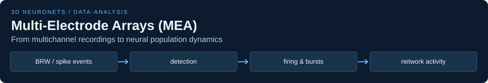
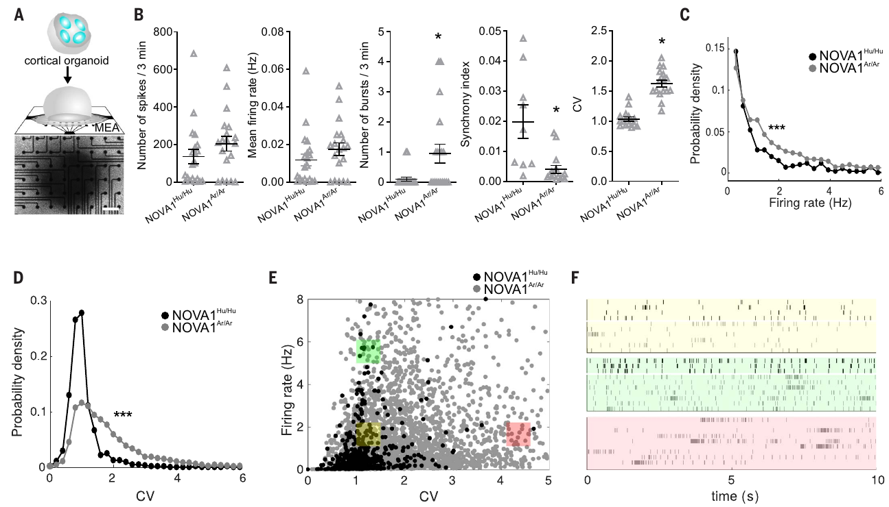
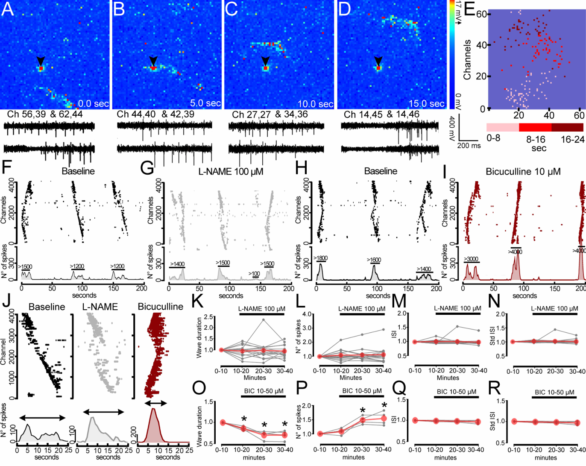

[← Portfolio](../../README.md) · [Data Analysis](../README.md)

### From large-scale neuronal recordings to quantitative insights into network activity and function.

We develop and customize advanced computational workflows for analyzing multielectrode array (MEA) recordings, transforming complex electrophysiological datasets into meaningful measurements of neuronal activity, functional connectivity, and collective network dynamics.

Combining spike detection, neuronal firing characterization, burst analysis, synchronization metrics, and statistical methods, our solutions enable researchers to investigate functional differences across experimental conditions, characterize neural network development, and evaluate responses to pharmacological or genetic interventions.

From human cortical organoids to high-density retinal recordings, we provide adaptable computational approaches that connect experimental electrophysiology with quantitative assessments of neural network function.

## Key Capabilities

Our MEA analysis solutions combine electrophysiological signal processing, quantitative neuronal activity characterization, and advanced network analysis. We develop flexible computational pipelines tailored to specific recording platforms, experimental protocols, and research objectives.

| Capability | What We Offer |
|---|---|
| **MEA & HD-MEA Data Processing** | Processing and organization of multichannel electrophysiological recordings, including signal inspection, electrode selection, channel quality assessment, and preparation for downstream analysis. |
| **Neuronal Firing & Variability Analysis** | Quantification of firing rates, interspike intervals, spike-train variability, and activity distributions across recording channels or identified units. |
| **Burst Detection & Population Dynamics** | Identification of spontaneous bursts, characterization of bursting statistics, and analysis of coordinated activity across neuronal populations. |
| **Synchronization Analysis** | Quantitative evaluation of temporal coordination, synchrony, population firing patterns, and changes in collective neuronal behavior. |
| **Functional Connectivity & Graph Analysis** | Estimation of statistical relationships between neuronal activity patterns using measures such as STTC and transfer entropy, together with network topology analysis. |
| **Spatiotemporal Activity Mapping** | Reconstruction and visualization of spatially organized neuronal activity, propagating waves, and population-level activation patterns using high-density electrode arrays. |
| **Comparative Experimental Analysis** | Statistical characterization and comparison of neuronal activity across experimental groups, developmental stages, pharmacological interventions, or genetic conditions. |
| **Customized Computational Pipelines** | Development of analysis scripts, parameter configurations, statistical workflows, and publication-ready visualizations adapted to experimental datasets. |

**Applications:** Human brain organoids · Neuronal cultures · Retinal electrophysiology · Drug-response studies · Neural development · Functional connectivity · HD-MEA analysis · Network synchronization

## Research Applications

### Multiscale Electrophysiological Characterization of Human Cortical Organoids

Advanced MEA analysis was used to characterize spontaneous neuronal activity and network organization in human cortical organoids, as demonstrated in a collaborative study published in **Science**. By combining spike sorting, firing-rate measurements, burst detection, synchronization analysis, and spike-train variability, the research identified distinct electrophysiological profiles associated with different NOVA1 genetic variants.

This work demonstrates our expertise in **extracting functional information from complex neuronal recordings, identifying differences in network organization, and developing quantitative approaches for comparing experimental conditions**, providing valuable tools for organoid research and functional phenotyping.

*Functional electrophysiological profiling of human cortical organoids. MEA-based characterization of neuronal activity across NOVA1 genetic variants, including spike and burst counts, firing rates, network synchronization, and interspike-interval variability. Statistical distributions, joint firing-rate–variability analysis, and representative spike raster plots reveal distinct patterns of neuronal firing and network organization across experimental conditions.*

**Research reference:** Trujillo et al. (2021). *Reintroduction of the archaic variant of NOVA1 in cortical organoids alters neurodevelopment.* Science. [DOI](https://doi.org/10.1126/science.aax2537).

---

### High-Density MEA Analysis of Retinal Network Dynamics

High-density multielectrode recordings were analyzed to characterize spontaneous neuronal activity, spatial wave propagation, and functional network organization in developing retinal circuits. Using 4,096 recording channels, the study combined spike detection, spatiotemporal activity mapping, wave characterization, and quantitative network analysis to evaluate the effects of pharmacological interventions.

This research demonstrates our expertise in **large-scale electrophysiological data processing, spatial activity reconstruction, and comparative network analysis**, providing computational approaches for investigating complex neuronal dynamics and identifying functional alterations across experimental conditions. [Public recording dataset](https://zenodo.org/records/20148989).

*Spatiotemporal characterization of retinal activity using high-density MEA recordings. Analysis of spontaneous retinal waves recorded across a 4,096-electrode array, including spatial activation maps, spike raster plots, wave propagation, and quantitative measurements of wave duration and neuronal firing. Comparative analysis across experimental conditions demonstrates how HD-MEA recordings can be transformed into detailed descriptions of population activity and spatiotemporal network dynamics. Source: [Walter et al. (2026), article-in-press version](https://doi.org/10.1038/s41420-026-03228-2); [CC BY 4.0](https://creativecommons.org/licenses/by/4.0/).*

**Research reference:** Walter et al. (2026). *Nitric oxide refines retinal circuit architecture independently of retinal wave dynamics.* Cell Death Discovery. [DOI](https://doi.org/10.1038/s41420-026-03228-2).

## Software & implementations

| Implementation | Scope |
|---|---|
| [HD-MEA and transfer-entropy research notebooks](hd-mea-aging-workflows/README.md) | Spike detection and channel masking with HerdingSpikes; directed statistical-dependence graphs with surrogate testing. Also contains companion patch-clamp notebooks. Input recordings are not distributed. |

The bundled code is research-stage material supplied for review. Confirm release rights and environment compatibility before publishing or reuse. No end-to-end reproduction is claimed.

## Related capabilities

[Functional & Anatomical Networks](../functional-anatomical-networks/README.md) · [Whole-Cell Patch Clamp](../whole-cell-patch-clamp/README.md) · [Models to Study Aging](../../Data-Driven-Models/model-to-study-aging/README.md)

## Transform your MEA recordings into quantitative inshights

**Working with neuronal cultures, human brain organoids, retinal preparations, or high-density electrophysiological datasets?**

3D NeuroNets develops customized computational solutions to extract neuronal activity, characterize firing and synchronization, reconstruct functional interactions, and identify differences between experimental conditions.

From exploratory data analysis to advanced network characterization, we help research teams transform complex MEA recordings into quantitative scientific results.

[Explore 3D NeuroNets](https://3dneuronets.github.io/) · [Contact Us](https://3dneuronets.github.io/#contact)

*Research applications are collaborative academic contributions and demonstrate expertise; they are not represented as completed commercial contracts.*
