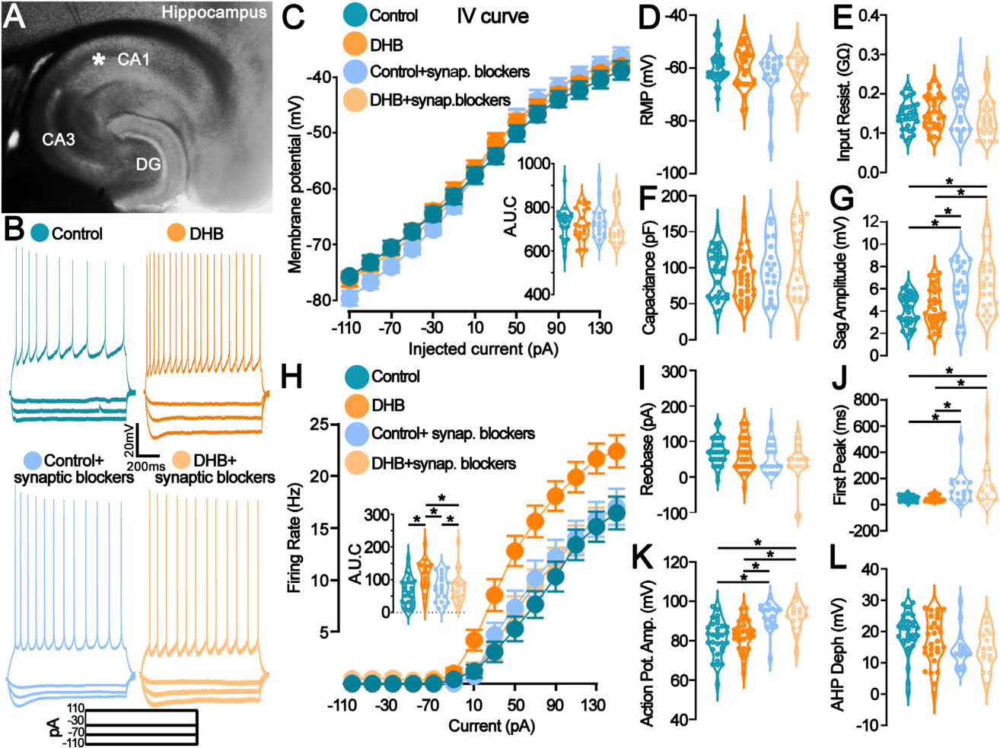
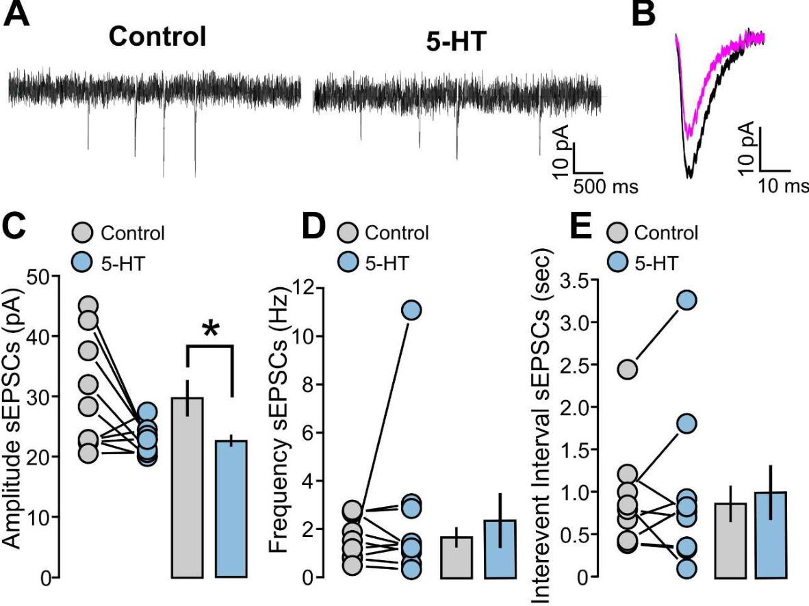
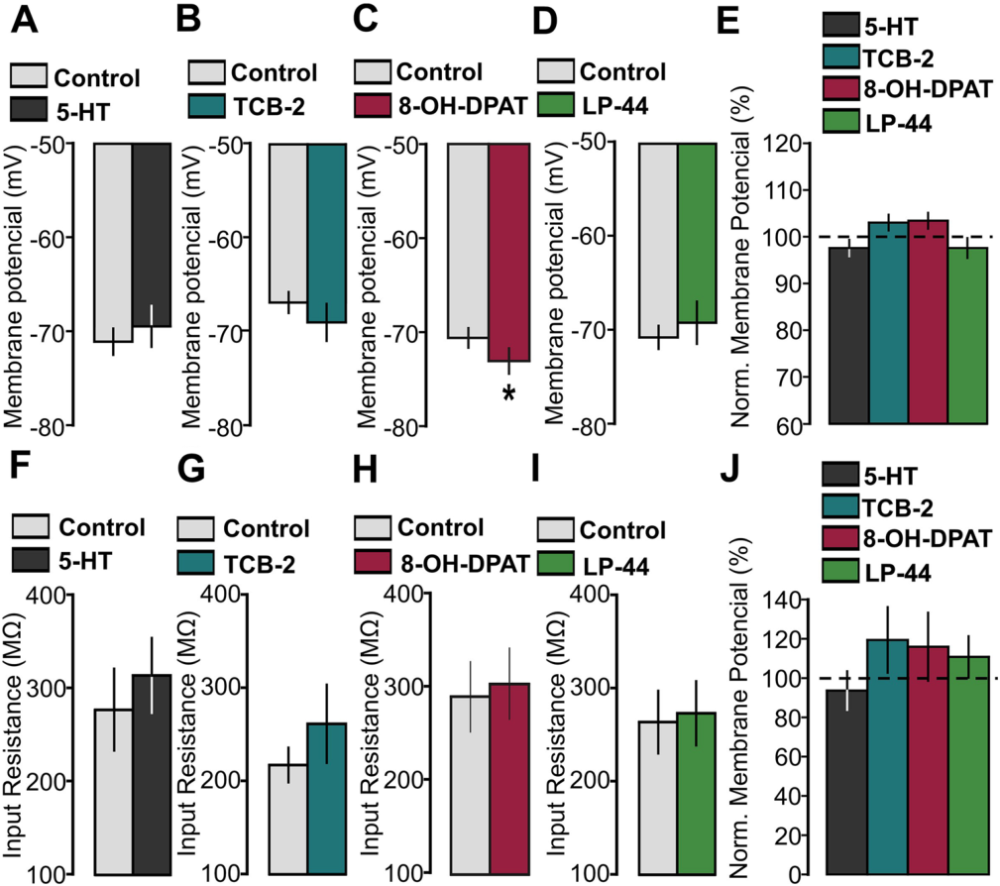
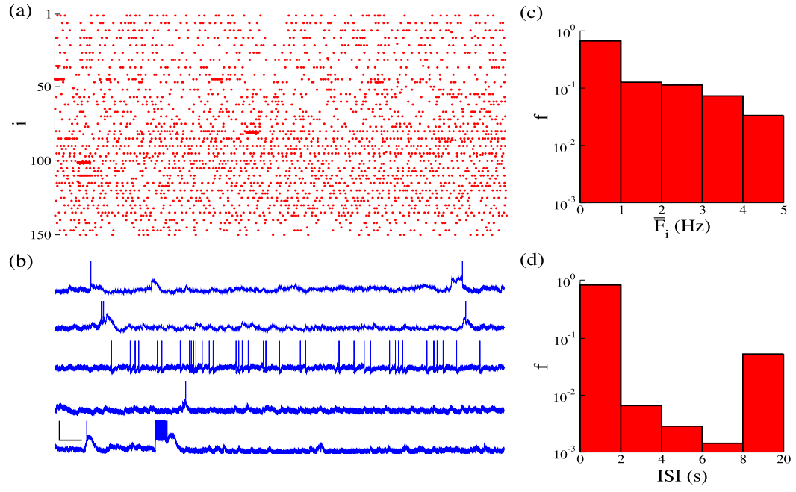

[← Portfolio](../../README.md) · [Data Analysis](../README.md)

**From intracellular recordings to comprehensive electrophysiological characterization of neuronal function.**

We develop and customize computational workflows for analyzing whole-cell patch-clamp recordings, transforming complex electrophysiological signals into quantitative measurements of neuronal excitability, membrane properties, and synaptic activity.

Combining advanced signal processing, automated feature extraction, event detection, and statistical analysis, our solutions enable researchers to characterize neuronal responses, investigate cellular mechanisms, and identify functional differences across experimental conditions.

From intrinsic membrane properties and action-potential dynamics to spontaneous synaptic currents and plasticity-related responses, we provide adaptable analytical approaches to support neuroscience research, pharmacological investigations, and data-driven neuronal modeling.

## Key Capabilities

Our whole-cell electrophysiology analysis solutions combine intracellular signal processing, quantitative feature extraction, and statistical characterization of neuronal activity. We develop flexible workflows tailored to experimental protocols, recording conditions, and specific research objectives.

| Capability | What We Offer |
|---|---|
| **Current-Clamp & Voltage-Clamp Data Analysis** | Processing and quantitative analysis of intracellular recordings, including protocol-specific segmentation, signal filtering, baseline characterization, and measurement extraction. |
| **Passive Membrane Property Characterization** | Estimation of resting membrane potential, input resistance, membrane time constant, capacitance, voltage sag, and current–voltage relationships. |
| **Neuronal Excitability & Firing Analysis** | Quantification of rheobase, firing rates, frequency–current relationships, spike-frequency adaptation, and responses to injected-current protocols. |
| **Spontaneous Synaptic Event Analysis** | Detection and characterization of postsynaptic current events, including amplitude, inter-event intervals, rise characteristics, waveform width, and decay kinetics. |
| **Evoked Synaptic Responses & Plasticity** | Analysis of stimulation-evoked synaptic responses, paired-pulse measurements, and activity-dependent changes in synaptic transmission. |
| **Comparative Electrophysiological Analysis** | Quantitative comparison of neuronal properties across experimental groups, pharmacological treatments, developmental stages, and other biological conditions. |
| **Customized Analysis Pipelines** | Development of automated processing scripts, parameter extraction workflows, statistical analyses, and publication-ready visualizations tailored to experimental datasets. |

**Applications:** Neuronal excitability · Intrinsic membrane properties · Action-potential analysis · Synaptic transmission · Pharmacological modulation · Synaptic plasticity · Electrophysiological phenotyping · Biophysical model parameterization

## Research Applications

### Quantitative Electrophysiological Profiling of Hippocampal Neurons

Whole-cell patch-clamp recordings were analyzed to characterize the intrinsic electrophysiological properties and excitability of hippocampal CA1 pyramidal neurons under different pharmacological conditions. Combining passive membrane measurements, action-potential characterization, and firing–current analysis, the study identified changes in neuronal responsiveness associated with β-hydroxybutyrate treatment.

This research demonstrates our expertise in **automated electrophysiological feature extraction, quantitative neuronal phenotyping, and comparative analysis of pharmacological interventions**, providing computational approaches for investigating how experimental treatments influence cellular function.

*Comprehensive electrophysiological characterization of hippocampal neuronal excitability. Whole-cell current-clamp analysis of CA1 pyramidal neurons under different pharmacological conditions, including representative membrane potential responses, current–voltage relationships, firing–current curves, and quantitative measurements of passive and active membrane properties. Comparative analysis reveals treatment-related changes in neuronal excitability. Source: [Zampieri et al. (2025), Figure 1](https://doi.org/10.3389/fphar.2025.1557612); [CC BY 4.0](https://creativecommons.org/licenses/by/4.0/).*

**Research reference:** Zampieri et al. (2025). *Exposure to β-hydroxybutyrate reduces the operating set point and increases excitability in hippocampal circuitry of healthy mice.* Frontiers in Pharmacology. [DOI](https://doi.org/10.3389/fphar.2025.1557612).

---

### Synaptic Current Analysis and Excitation–Inhibition Balance

Advanced analysis of whole-cell recordings was used to characterize spontaneous and evoked synaptic activity in cortical neurons and investigate how serotonergic modulation influences excitatory and inhibitory transmission. Through quantitative measurements of postsynaptic current amplitudes, event frequencies, inter-event intervals, and evoked responses, the study identified changes in synaptic signaling across experimental conditions.

This work demonstrates our expertise in **synaptic event detection, waveform characterization, and quantitative analysis of excitatory and inhibitory transmission**, supporting investigations of neuronal communication, pharmacological modulation, and excitation–inhibition balance.

*Quantitative analysis of spontaneous synaptic currents in cortical neurons. Whole-cell voltage-clamp recordings were used to characterize spontaneous excitatory postsynaptic currents and their modulation by serotonin. Representative current traces, event amplitudes, frequencies, and inter-event intervals demonstrate how computational analysis can quantify synaptic activity and identify functional differences across experimental conditions. Source: [Carlos-Lima et al. (2024), Figure 1](https://doi.org/10.3390/ijms25010519); [CC BY 4.0](https://creativecommons.org/licenses/by/4.0/).*

**Research reference:** Carlos-Lima et al. (2024). *Serotonergic Modulation of the Excitation/Inhibition Balance in the Visual Cortex.* International Journal of Molecular Sciences. [DOI](https://doi.org/10.3390/ijms25010519).

---

### Pharmacological Modulation of Neuronal Excitability and Synaptic Plasticity

Electrophysiological recordings from prelimbic cortical neurons were used to investigate how pharmacological inhibition of TREK-1 potassium channels influences synaptic transmission and neuronal function. Quantitative analysis of evoked synaptic responses, plasticity-related changes, and intrinsic membrane properties enabled the characterization of functional effects associated with channel modulation.

This research demonstrates our expertise in **comparative electrophysiological analysis, synaptic plasticity characterization, and investigation of pharmacological effects on neuronal activity**, supporting experimental studies of ion-channel function and cellular signaling.

**Research reference:** Francis-Oliveira et al. (2024). *TREK-1 inhibition promotes synaptic plasticity in the prelimbic cortex.* Experimental Neurology. [DOI](https://doi.org/10.1016/j.expneurol.2023.114652).

---

### Developmental Electrophysiology and Neuromodulatory Responses

Whole-cell recordings from prefrontal cortical neurons were used to investigate how developmental stage and serotonergic signaling influence neuronal properties and synaptic plasticity. Quantitative analysis of intrinsic membrane characteristics, synaptic responses, and stimulation-induced plasticity enabled comparisons of neuronal function across experimental conditions.

This research demonstrates our expertise in **developmental electrophysiological profiling, neuromodulatory response analysis, and quantitative characterization of neuronal plasticity**, supporting investigations of brain maturation and changes in cellular function.

*Comparative analysis of intrinsic membrane properties under serotonergic modulation. Quantitative measurements of resting membrane potential and input resistance in prefrontal cortical neurons under serotonin and receptor-specific pharmacological treatments. The analysis illustrates how intracellular electrophysiological recordings can be used to characterize cellular responses and compare intrinsic properties across experimental conditions. Source: [Higa et al. (2022), Figure 9](https://doi.org/10.1038/s41598-022-23767-9); [CC BY 4.0](https://creativecommons.org/licenses/by/4.0/).*

**Research reference:** Higa et al. (2022). *5-HT-dependent synaptic plasticity of the prefrontal cortex in postnatal development.* Scientific Reports. [DOI](https://doi.org/10.1038/s41598-022-23767-9).

---

### Experimental Characterization of Spontaneous Hippocampal Activity

Intracellular electrophysiological recordings from hippocampal CA1 neurons were analyzed to characterize spontaneous firing patterns, low-frequency neuronal activity, and irregular bursting. The extracted activity characteristics were compared with computational network simulations to investigate mechanisms supporting self-sustained neuronal firing.

This work demonstrates our expertise in **spontaneous neuronal activity analysis, electrophysiological feature characterization, and experimental–computational comparison**, illustrating how intracellular recordings can inform the development and evaluation of neuronal network models.

*Experimental characterization and computational modeling of spontaneous hippocampal activity. Intracellular recordings from CA1 neurons illustrate spontaneous, irregular low-frequency firing, while numerical network simulations reproduce qualitatively similar patterns of neuronal activity. The comparison demonstrates how electrophysiological measurements can provide quantitative reference properties for developing computational neuronal networks.*

**Research reference:** Borges et al. (2020). *Self-sustained activity of low firing rate in balanced networks.* Physica A. [DOI](https://doi.org/10.1016/j.physa.2019.122671).

---

### Data-Driven Characterization of Stochastic Neuronal Responses

Intracellular electrophysiological measurements provide a foundation for characterizing variability in neuronal responses and developing experimentally informed computational models. In this study, a method was proposed to estimate voltage-dependent spike-probability functions from in vitro recordings and incorporate them into stochastic neuronal simulations.

This research illustrates our expertise in **extracting computationally useful information from electrophysiological measurements and connecting experimental neuronal behavior with mathematical models**, supporting the development of data-driven representations of neuronal excitability.

**Research reference:** Lima et al. (2021). *Modeling and characterizing stochastic neurons based on in vitro voltage-dependent spike probability functions.* European Physical Journal Special Topics. [DOI](https://doi.org/10.1140/epjs/s11734-021-00160-7).

## Software & implementations

| Implementation | Scope |
|---|---|
| [Whole-cell electrophysiology notebooks](whole-cell-electrophysiology/README.md) | Four ABF/eFEL notebooks: passive responses, F–I, first-three-spike summaries and spontaneous negative-going events. |
| [Aging and hippocampal dysfunction — companion patch-clamp analysis](../multi-electrode-arrays/hd-mea-aging-workflows/README.md) | Two notebooks characterize active and passive features; access the shared implementation rather than duplicating the code. |

The bundled code is research-stage material supplied for review. Confirm release rights and environment compatibility before publishing or reuse. No end-to-end reproduction is claimed.

## Related capabilities

[Multi-Electrode Arrays (MEA)](../multi-electrode-arrays/README.md) · [Rat Hippocampal Model](../../Data-Driven-Models/rat-hippocampus-model/README.md) · [Models to Study Aging](../../Data-Driven-Models/model-to-study-aging/README.md) · [Ionic Channel Models](../../Data-Driven-Models/ionic-channels-model/README.md)

## Extract More Information From Your Intracellular Recordings

**Have whole-cell patch-clamp recordings that require advanced electrophysiological analysis?**

3D NeuroNets develops customized computational workflows to characterize neuronal excitability, quantify passive and active membrane properties, analyze synaptic activity, and compare electrophysiological responses across experimental conditions.

From automated feature extraction to biophysical model parameterization, we help researchers transform intracellular recordings into quantitative scientific insights.

[Explore 3D NeuroNets](https://3dneuronets.github.io/) · [Contact Us](https://3dneuronets.github.io/#contact)

*Research applications are collaborative academic contributions and demonstrate expertise; they are not represented as completed commercial contracts.*
