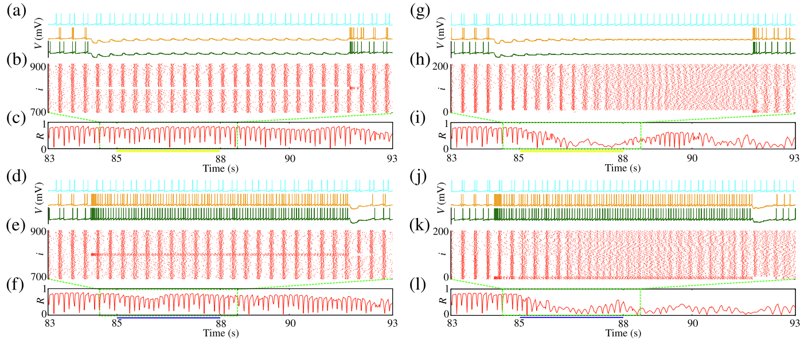
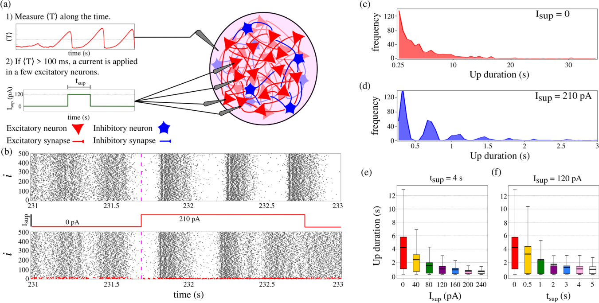

[← Portfolio](../../README.md) · [Data Driven Models](../README.md)

### From electric-field stimulation to cellular responses and large-scale network dynamics.

We develop and customize biophysically detailed neuronal models to investigate how externally applied electric fields influence neuronal excitability, synaptic interactions, and collective brain activity. By integrating realistic neuronal morphologies, ionic mechanisms, and complex network architectures, our computational approaches support the investigation of transcranial alternating current stimulation (tACS), transcranial magnetic stimulation (TMS), and other neuromodulation strategies.

Our modeling frameworks enable researchers to explore how stimulation parameters and neuronal properties influence cellular and circuit-level responses, providing a flexible computational environment for comparing stimulation protocols, investigating underlying mechanisms, and guiding experimental research.

## Key Capabilities

Our computational stimulation solutions combine detailed neuronal modeling, extracellular electric-field interactions, and large-scale network simulations. These approaches provide adaptable frameworks for investigating neuronal sensitivity to stimulation, exploring stimulation parameters, and evaluating changes in cellular and population dynamics.

| Capability | What We Offer |
|---|---|
| **Extracellular Electric-Field Modeling** | Integration of prescribed or externally computed electric fields into neuronal simulations to investigate membrane polarization and stimulation-induced responses. |
| **Morphology-Dependent Stimulation Analysis** | Investigation of how neuronal morphology, cellular orientation, and spatial distribution influence sensitivity to extracellular stimulation. |
| **tACS & TMS Protocol Investigation** | Computational evaluation of stimulation waveforms, frequencies, amplitudes, field orientations, and temporal patterns using appropriate stimulation models. |
| **Single-Neuron Biophysical Simulations** | Analysis of stimulation effects on multicompartmental neuronal models incorporating detailed morphologies, voltage-dependent ionic channels, and intrinsic electrophysiological properties. |
| **Large-Scale Network Stimulation** | Integration of stimulation protocols into biologically detailed cortical and thalamocortical circuits to investigate population-level responses. |
| **Neural Oscillations & Synchronization Analysis** | Quantitative characterization of stimulation-related changes in neuronal firing, phase relationships, population synchronization, and oscillatory activity. |

**Applications:** Non-invasive brain stimulation · tACS · TMS · Human neuron modeling · Thalamocortical networks · Neural oscillations · Electric-field interactions · Computational neuromodulation

## Research applications

### Morphology-Dependent Stimulation of Human Neurons

Biophysically detailed human neuronal models provide a computational framework for investigating how extracellular electric fields interact with complex neuronal morphologies. By incorporating realistic cellular geometry and intrinsic membrane properties, these simulations can characterize stimulation-induced polarization, neuronal excitability, and sensitivity to field orientation and temporal stimulation patterns.

This approach supports the development of customized single-neuron stimulation models and the investigation of how anatomical and electrophysiological differences influence responses to non-invasive brain stimulation.

### tACS in Large-Scale Thalamocortical Networks

Biophysically detailed thalamocortical network models provide a powerful computational environment for investigating the effects of transcranial alternating current stimulation on neuronal populations and collective brain dynamics. By incorporating stimulation protocols into anatomically and physiologically constrained circuits, these models can be used to explore how stimulation frequency, amplitude, and timing influence neuronal activity, synchronization, and network oscillations.

This approach connects cellular responses to stimulation with emergent network behavior, supporting the evaluation of neuromodulation protocols within complex, biologically realistic neural circuits.

### TMS-Informed Modeling of Human Cortical Microcircuits

Detailed computational models of human cortical neurons and microcircuits provide a framework for investigating cellular and network-level responses to stimulation induced by transcranial magnetic stimulation. By integrating extracellular stimulation with biophysical neuronal dynamics, these simulations support the examination of stimulation-related changes in membrane activity and collective network behavior.

This research direction demonstrates the application of high-performance neuronal simulations to investigate mechanistic questions in non-invasive brain stimulation.

### External pulsed currents in a human structural network

A regional structural connectivity matrix is used to investigate how periodic pulses modify burst synchronization.

**Research reference:** Sayari et al. (2023). *Analyzing bursting synchronization in structural connectivity matrix of a human brain under external pulsed currents.* Chaos. [DOI](https://doi.org/10.1063/5.0135399).

---

### Model-based optogenetic stimulation for seizure suppression

Experimentally informed neuronal network models were used to evaluate optogenetic-like stimulation strategies for controlling pathological synchronization. Excitatory and inhibitory stimulation targeting highly connected neuronal populations effectively suppressed synchronized bursting in the model, demonstrating how computational simulations can identify potential stimulation targets and guide the development of neuromodulation strategies.

*Targeted optogenetic-like stimulation for seizure suppression. Computational evaluation of inhibitory (yellow light) and excitatory (blue light) stimulation applied to non-IAINs (left) and highly connected IAINs (right). Membrane potential traces, spike raster plots, and the synchronization order parameter demonstrate that selectively modulating IAINs disrupts pathological burst synchronization, whereas equivalent stimulation of non-IAINs fails to suppress seizure-like activity.*

**Research reference:** Borges et al. (2023). *Intermittency properties in a temporal lobe epilepsy model.* Epilepsy & Behavior. [DOI](https://doi.org/10.1016/j.yebeh.2022.109072).

---

### Biomarker-driven stimulation for seizure suppression

Computational neuronal network models incorporating human brain structural connectivity were used to investigate how periodic electrical stimulation influences bursting activity and network synchronization. By exploring stimulation parameters and their effects on collective neuronal dynamics, the study demonstrates how computational simulations can support the evaluation of stimulation protocols and the investigation of network-level responses to external perturbations.

*Simulated intervention and comparison of activity with and without suppression. Source: [Souza et al. (2026), Figure 6](https://doi.org/10.1038/s41598-026-44063-w); [CC BY 4.0](https://creativecommons.org/licenses/by/4.0/).*

**Research reference:** Souza et al. (2026). *Neuronal silence as a predictive biomarker and target for epileptic seizures suppression.* Scientific Reports. [DOI](https://doi.org/10.1038/s41598-026-44063-w).

## Software & implementations

| Implementation | Scope |
|---|---|
| [Thalamocortical stimulation extension](../rat-thalamocortical-model/thalamocortical-stimulation/README.md) | Current injection into VPM cells and network-response analysis; not a released tACS/TMS field solver. |
| [Neuronal silence model](../model-to-study-epilepsy/neuronal-silence/README.md) | Related code for spontaneous network dynamics and prediction; the actual suppression implementation is not included. |

The bundled code is research-stage material supplied for review. Confirm release rights and environment compatibility before publishing or reuse. No end-to-end reproduction is claimed.

## Related capabilities

[Rat Thalamocortical Model](../rat-thalamocortical-model/README.md) · [Models to Study Epilepsy](../model-to-study-epilepsy/README.md) · [Human Cortical Model](../human-cortical-model/README.md)

## Discuss your research

[Explore 3D NeuroNets](https://3dneuronets.github.io/) · [Contact us](https://3dneuronets.github.io/#contact)

*Research applications are collaborative academic contributions and demonstrate expertise; they are not represented as completed commercial contracts.*
