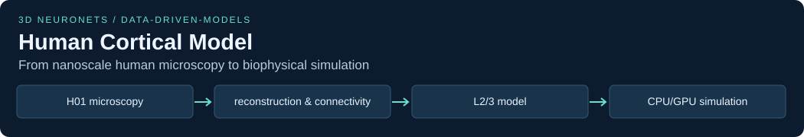
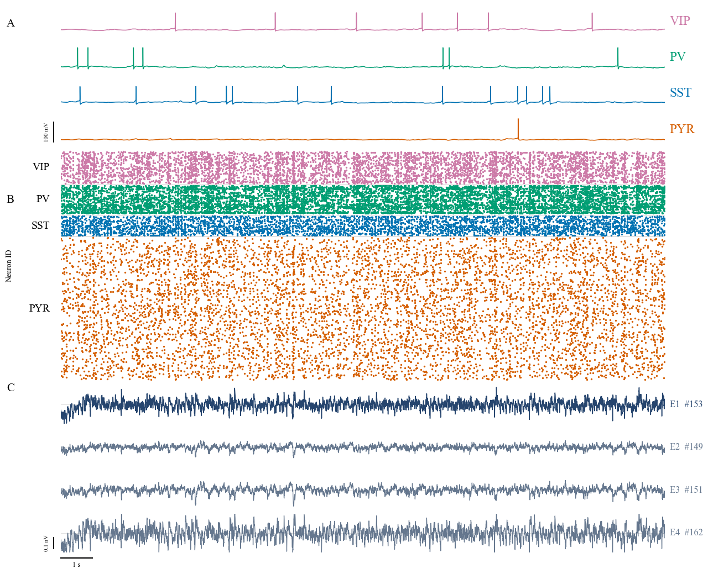
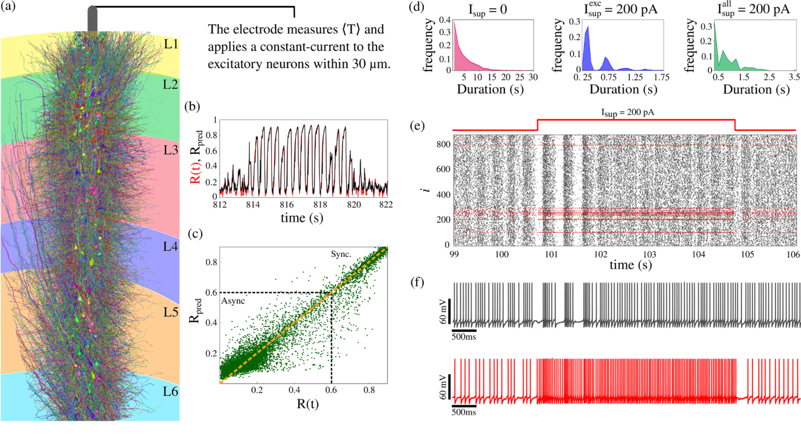

[← Portfolio](../../README.md) · [Data Driven Models](../README.md)

### From human electron microscopy to biophysically detailed simulations of cortical microcircuits.

We develop and customize data-driven computational models of human cortical networks by integrating anatomical reconstructions, synaptic connectivity, neuronal morphology, and experimental electrophysiology. Our modeling approaches bridge detailed biological measurements with large-scale neuronal simulations, enabling the reconstruction of complex cortical circuits and the investigation of their emergent dynamics.

Combining realistic multicompartmental neurons, experimentally informed synaptic mechanisms, and high-performance simulation technologies, we provide adaptable computational frameworks for exploring human-specific brain function, testing biological hypotheses, and investigating how cellular and connectivity alterations influence network activity.

## Key Capabilities

Our human cortical modeling solutions integrate anatomical connectivity, detailed neuronal biophysics, and high-performance computational simulation. We develop customizable modeling frameworks that transform experimental datasets into functional neuronal networks, allowing researchers to investigate brain activity across multiple biological scales.

| Capability | What We Offer |
|---|---|
| **Human Connectomics Integration** | Processing and integration of neuronal positions, cell classifications, observed connections, and connectivity statistics derived from large-scale anatomical datasets. |
| **Data-Driven Cortical Reconstruction** | Development of spatially organized neuronal networks incorporating experimental anatomical constraints, cell-type distributions, and customized connectivity architectures. |
| **Biophysically Detailed Neuronal Models** | Integration and customization of multicompartmental neuronal morphologies, voltage-dependent ionic channels, intrinsic electrophysiological properties, and compartment-specific dynamics. |
| **Synaptic Connectivity & Circuit Architecture** | Implementation of excitatory and inhibitory pathways, experimentally informed synaptic physiology, distance-dependent connectivity, and short-term synaptic plasticity. |
| **High-Performance Network Simulations** | Development and adaptation of computationally demanding neuronal models using NetPyNE, NEURON, CoreNEURON, and parallel CPU/GPU simulation workflows. |
| **Network Dynamics & Functional Analysis** | Characterization of neuronal firing, membrane potential dynamics, excitation–inhibition balance, population synchronization, and emergent network activity. |
| **Model Customization & Virtual Experiments** | Investigation of cell-type-specific properties, synaptic strengths, neuronal excitability, and connectivity alterations through configurable simulation experiments and parameter exploration. |
| **Model Validation & Experimental Comparison** | Quantitative comparison of network structure and simulated activity with available anatomical, connectivity, and electrophysiological constraints. |

**Applications:** Human cortical reconstruction · Connectomics-driven modeling · Biophysical network simulations · Cortical excitation–inhibition balance · Human brain disorders · High-performance computational neuroscience

## Research Applications

### H01-Informed Reconstruction of a Human Cortical L2/3 Microcircuit

A biophysically detailed human cortical layer 2/3 network is being developed by integrating spatial and connectivity information from the H01 human temporal cortex dataset with multicompartmental neuronal models and experimentally informed synaptic physiology.

The current implementation incorporates **1,250 neurons across four populations pyramidal (PYR), somatostatin (SST), parvalbumin (PV), and vasoactive intestinal peptide (VIP) interneurons**. Anatomical positions and observed H01 connections provide the structural foundation, complemented by statistically modeled connections derived from population-specific distance-dependent connectivity rules.

Implemented using **NetPyNE, NEURON, and CoreNEURON**, this ongoing development demonstrates our capability to transform large-scale connectomic data into adaptable, biophysically detailed cortical simulations, providing a foundation for investigating human network dynamics, cellular interactions, and the effects of circuit-level alterations.

*Biophysically detailed simulation of human cortical network activity. Representative membrane potential traces, population spike raster plots and four EEG electrodes from a human L2/3 microcircuit containing pyramidal, SST, PV, and VIP neurons. The simulations enable cell-type-specific characterization of firing patterns and collective network dynamics, providing a computational framework for investigating the relationship between cellular physiology, synaptic interactions, and emergent cortical activity. Source: H01-informed human L2/3 model development using NetPyNE and NEURON.*

### Connectomics-Driven Modeling of Human Cortical Network Dynamics

Human cortical connectivity data from the H01 dataset were incorporated into computational neuronal network simulations to investigate the relationship between anatomical structure and abnormal synchronization. By combining experimentally reconstructed connections with conductance-based neuronal dynamics, the study explored how human cortical connectivity influences collective activity and seizure-like network behavior.

This research demonstrates our expertise in **translating connectomic measurements into functional network models**, providing a foundation for investigating human cortical dynamics and exploring the network mechanisms associated with neurological disorders.

*From human cortical connectomics to functional network simulations. Anatomically informed neuronal network modeling based on the H01 human temporal cortex dataset, linking reconstructed structural connectivity to simulated population dynamics and seizure-like synchronization. The approach demonstrates how human connectomic information can be incorporated into computational models to investigate the relationship between circuit architecture and collective neuronal activity.*

**Research reference:** Souza et al. (2026). *Neuronal silence as a predictive biomarker and target for epileptic seizures suppression.* Scientific Reports. [DOI](https://doi.org/10.1038/s41598-026-44063-w).

## Typical Outputs

Our human cortical modeling workflows can be tailored to specific experimental datasets, research objectives, and computational requirements.

| Deliverable | Description |
|---|---|
| **Custom Cortical Network Models** | Configurable neuronal networks incorporating selected cell populations, biophysical mechanisms, spatial organization, and synaptic connectivity. |
| **Anatomical & Connectivity Reconstructions** | Three-dimensional network representations, neuronal distributions, connectivity matrices, and quantitative structural characterization. |
| **Biophysical Simulation Data** | Membrane potential recordings, neuronal spike trains, firing-rate distributions, and other cell- and population-level activity measurements. |
| **Network Dynamics Analysis** | Quantitative evaluation of excitation–inhibition interactions, population synchronization, oscillatory activity, and responses to parameter changes. |
| **Model Configuration & Reproducibility** | Documented simulation configurations, parameter sets, analysis scripts, and computational workflows appropriate to the project. |
| **High-Performance Simulation Workflows** | CPU/GPU-oriented simulation configurations, compatibility assessments, and performance characterization when supported by the target environment. |

**Additional development areas:** Extracellular field potential calculation · Current-dipole recording · EEG forward modeling · Large-scale parameter optimization · Disease-specific cortical network configurations

## Scientific Foundation

The human cortical modeling framework integrates concepts and computational approaches from complementary research in human connectomics, neuronal biophysics, and network dynamics.

| Scientific Foundation | Reference |
|---|---|
| **Human Cortical Connectomics** | Shapson-Coe et al. (2024). *A petavoxel fragment of human cerebral cortex reconstructed at nanoscale resolution.* Science. [DOI](https://doi.org/10.1126/science.adk4858). |
| **Biophysically Detailed Human Microcircuits** | Yao et al. (2022). *Reduced inhibition in depression impairs stimulus processing in human cortical microcircuits.* Cell Reports. [DOI](https://doi.org/10.1016/j.celrep.2021.110232). |
| **H01-Informed Network Dynamics** | Souza et al. (2026). *Neuronal silence as a predictive biomarker and target for epileptic seizures suppression.* Scientific Reports. [DOI](https://doi.org/10.1038/s41598-026-44063-w). |

## Related capabilities

[Functional & Anatomical Networks](../../Data-Analysis/functional-anatomical-networks/README.md) · [Models to Study Epilepsy](../model-to-study-epilepsy/README.md) · [Rat Thalamocortical Model](../rat-thalamocortical-model/README.md) · [Ionic Channel Models](../ionic-channels-model/README.md)

## Develop a Custom Human Cortical Model

**Have experimental data, a connectomic dataset, or a research question that requires detailed neuronal simulations?**

3D NeuroNets can help translate biological measurements into computational cortical models tailored to your research objectives, from cellular biophysics and network reconstruction to large-scale simulation and quantitative analysis.

[Explore 3D NeuroNets](https://3dneuronets.github.io/) · [Contact Us](https://3dneuronets.github.io/#contact)