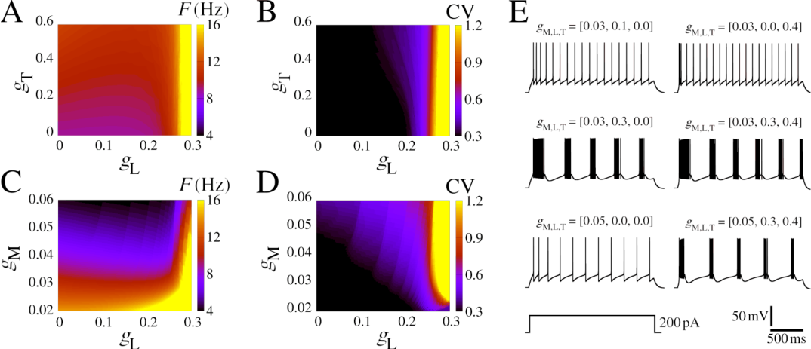

[← Portfolio](../../README.md) · [Data Driven Models](../README.md)

### From ionic mechanisms to neuronal excitability and network dynamics.

We develop and customize biophysically informed neuronal models to investigate how ionic channels regulate electrical activity, firing patterns, and cellular excitability. By integrating voltage-dependent membrane mechanisms, experimental electrophysiological constraints, and computational simulations, our modeling approaches provide insights into the mechanisms underlying neuronal function.

Our computational frameworks enable researchers to explore the effects of ionic conductance alterations, characterize transitions between firing regimes, and investigate how cellular properties influence collective network behavior. These models provide a flexible environment for testing mechanistic hypotheses, examining channel-specific contributions, and evaluating the potential consequences of changes in neuronal physiology.

## Key Capabilities

Our ionic channel modeling solutions combine neuronal biophysics, electrophysiological analysis, and computational simulations to investigate the mechanisms controlling neuronal excitability. We develop adaptable models that connect specific ionic currents with cellular responses and emergent network dynamics.

| Capability | What We Offer |
|---|---|
| **Custom Ionic Channel Modeling** | Development, integration, and modification of biophysical ionic current mechanisms, including voltage-dependent conductances and channel kinetics. |
| **Conductance-Based Neuronal Models** | Construction and customization of neuronal models incorporating multiple ionic currents, membrane properties, and electrophysiological characteristics. |
| **Electrophysiological Model Parameterization** | Investigation and adjustment of neuronal parameters using experimentally informed firing properties, membrane responses, and current-clamp measurements. |
| **Neuronal Excitability & Firing Analysis** | Quantitative characterization of action potentials, spike-frequency adaptation, firing-rate responses, bursting activity, and transitions between firing patterns. |
| **Dynamical Transitions** | Identification of neuronal and network parameter regimes associated with asynchronous spiking, synchronized bursting, bistability, and hysteresis. |
| **Cellular-to-Network Integration** | Incorporation of biophysical neuronal mechanisms into network simulations to investigate how changes at the cellular level influence population activity and synchronization. |

**Applications:** Neuronal excitability · Ion channel biophysics · Electrophysiological modeling · Spike-frequency adaptation · Channel conductance analysis · Bursting and bistability · Network synchronization

## Research Applications

### Ion Channel Modulation and Transitions in Neuronal Firing

Conductance-based neuronal models were developed to investigate how potassium and calcium currents regulate cellular excitability and collective network activity. The simulations characterized changes in spike-frequency adaptation, firing patterns, and transitions between asynchronous activity and synchronized bursting.

The study identified **bistable regimes in which distinct network activity patterns coexist**, demonstrating how changes in specific ionic mechanisms can reshape neuronal dynamics. This approach highlights our expertise in **biophysical model development, systematic parameter exploration, and the investigation of cellular mechanisms underlying complex network behavior**.

*Conductance-dependent firing regimes and voltage responses. Source: [Borges et al. (2023), Figure 2](https://doi.org/10.3390/brainsci13091347); [CC BY 4.0](https://creativecommons.org/licenses/by/4.0/). Figure cropped from supplied PDF; no data altered.*

**Research reference:** Borges et al. (2023). *The Roles of Potassium and Calcium Currents in the Bistable Firing Transition.* Brain Sciences. [DOI](https://doi.org/10.3390/brainsci13091347).

---

### Experimental Electrophysiology and Ion Channel Function

Experimental electrophysiological investigations provide an important foundation for understanding how ionic channels regulate neuronal activity. Research examining TREK-1 inhibition and synaptic plasticity in the prelimbic cortex illustrates how channel-specific modulation can influence neuronal function, providing biological context for developing experimentally informed models of cellular excitability.

**Research reference:** Francis-Oliveira et al. (2024). *TREK-1 inhibition promotes synaptic plasticity in the prelimbic cortex.* Experimental Neurology. [DOI](https://doi.org/10.1016/j.expneurol.2023.114652).

## Software & implementations

| Implementation | Scope |
|---|---|
| [Bistable firing transition](bistable-firing/README.md) | NetPyNE configurations, NMODL mechanisms, single-cell templates and parameter-space notebook; preserves the supplied study files. |

The bundled code is research-stage material supplied for review. Confirm release rights and environment compatibility before publishing or reuse. No end-to-end reproduction is claimed.

## Related capabilities

[Whole-Cell Patch Clamp](../../Data-Analysis/whole-cell-patch-clamp/README.md) · [Models to Study Epilepsy](../model-to-study-epilepsy/README.md) · [Models to Study Aging](../model-to-study-aging/README.md)

## Discuss your research

[Explore 3D NeuroNets](https://3dneuronets.github.io/) · [Contact us](https://3dneuronets.github.io/#contact)

*Research applications are collaborative academic contributions and demonstrate expertise; they are not represented as completed commercial contracts.*
