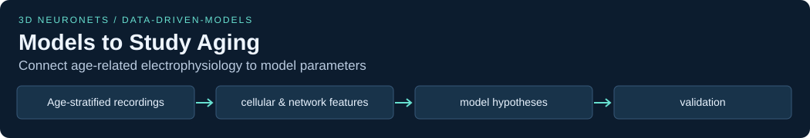

[← Portfolio](../../README.md) · [Data Driven Models](../README.md)

# Models to Study Aging

A research direction combining age-stratified neuronal physiology and population-network measurements with mechanistic modeling.

## Computational capabilities

| Stage | Work | Output |
|---|---|---|
| Measure | HD-MEA and whole-cell feature extraction | Age/group-specific distributions |
| Compare | Statistical comparisons and graph metrics | Candidate altered physiological constraints |
| Model (in development) | Translate measured features into candidate cell/network parameter sets | Testable hypotheses and model validation plan |

## Research applications

The supplied material establishes an analysis workflow rather than a published aging model. We will add approved model-validation figures and references when available.

## Software & implementations

| Implementation | Scope |
|---|---|
| [Aging and hippocampal dysfunction — electrophysiology](../../Data-Analysis/multi-electrode-arrays/hd-mea-aging-workflows/README.md) | Shared HD-MEA, graph and patch-clamp notebooks. Source group labels include SAMP2, SAMP8 and SAMP8-Caf. No unpublished conclusions or quantitative study claims are presented. |

The bundled code is research-stage material supplied for review. Confirm release rights and environment compatibility before publishing or reuse. No end-to-end reproduction is claimed.

## Additional scientific context

- Ikebara et al. (2025). *Hippocampal Interneurons Shape Spatial Coding Alterations in Neurological Disorders.* Molecular Neurobiology. [DOI](https://doi.org/10.1007/s12035-025-05020-2).

## Related capabilities

[Multi-Electrode Arrays (MEA)](../../Data-Analysis/multi-electrode-arrays/README.md) · [Whole-Cell Patch Clamp](../../Data-Analysis/whole-cell-patch-clamp/README.md) · [Functional & Anatomical Networks](../../Data-Analysis/functional-anatomical-networks/README.md) · [Rat Hippocampal Model](../rat-hippocampus-model/README.md) · [Ionic Channel Models](../ionic-channels-model/README.md)

## Discuss your research

[Explore 3D NeuroNets](https://3dneuronets.github.io/) · [Contact us](https://3dneuronets.github.io/#contact)

*Research applications are collaborative academic contributions and demonstrate expertise; they are not represented as completed commercial contracts.*
