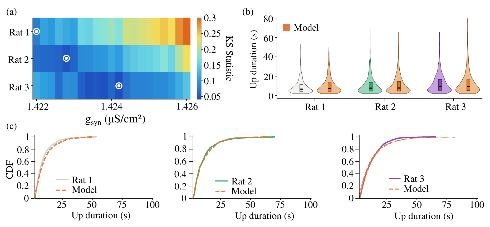
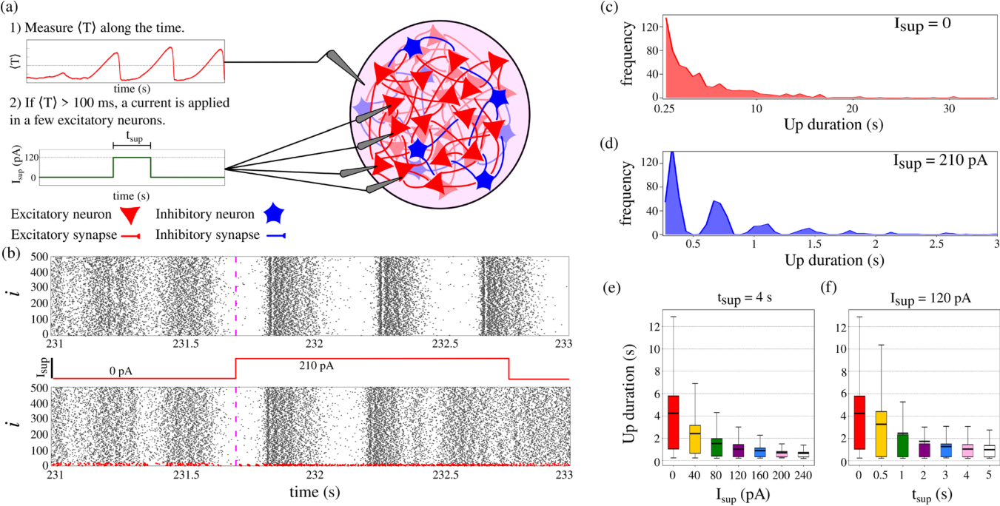

[← Portfolio](../../README.md) · [Data Driven Models](../README.md)

**From seizure mechanisms to predictive biomarkers and computational neuromodulation.**

We develop and customize biophysically informed neuronal network models to investigate the mechanisms underlying epileptic activity, seizure generation, and abnormal synchronization. By combining experimental electrophysiology, computational neuroscience, nonlinear dynamics, and machine learning, our approaches connect cellular and synaptic mechanisms with emergent pathological network behavior.

Our modeling frameworks enable researchers to reproduce seizure-like dynamics, identify early-warning signatures, investigate network alterations, and evaluate candidate stimulation strategies in silico. These adaptable computational environments support mechanistic hypothesis testing, experimental data integration, and the development of new approaches for understanding and controlling epileptic network activity.

## Key Capabilities

Our computational epilepsy research solutions integrate experimentally informed network modeling, advanced signal analysis, and simulation-based intervention strategies. We develop customizable frameworks to investigate seizure dynamics, identify mechanisms associated with pathological transitions, and evaluate potential approaches to network control.

| Capability | What We Offer |
|---|---|
| **Data-Driven Epileptic Network Modeling** | Development and customization of conductance-based neuronal networks incorporating biologically informed cellular properties, synaptic mechanisms, and connectivity architectures. |
| **Seizure Generation & Mechanistic Analysis** | Investigation of how neuronal excitability, ionic currents, excitation–inhibition balance, and synaptic interactions contribute to abnormal synchronization and spontaneous seizure-like activity. |
| **Dynamical Transition Analysis** | Characterization of network transitions between physiological and pathological activity through parameter exploration, hysteresis analysis, and nonlinear dynamical methods. |
| **Experimental EEG & Seizure Characterization** | Quantitative analysis of electrophysiological recordings to detect seizure events, characterize their temporal organization, and extract statistics for comparison with computational models. |
| **Predictive Biomarkers & Machine Learning** | Investigation of neuronal activity signatures associated with impending network transitions using time-series analysis, statistical modeling, and machine learning. |
| **Model Calibration & Experimental Comparison** | Optimization and evaluation of network parameters using experimentally observed activity patterns, seizure-duration distributions, and other quantitative measurements. |

**Applications:** Seizure mechanisms · Epileptiform synchronization · EEG analysis · Nonlinear dynamics · Biomarker discovery · Machine learning · Computational neuromodulation · Model-based hypothesis testing

## Research Applications

### Experimentally Informed Modeling of Spontaneous Seizure Generation

Conductance-based neuronal networks were developed to investigate how synaptic interactions and intrinsic ionic mechanisms contribute to spontaneous transitions into seizure-like activity. Combining **24-hour cortical EEG recordings from epileptic rats** with computational simulations, the models reproduced key temporal features of experimentally observed events. This research demonstrates our expertise in integrating experimental recordings with biophysical simulations, calibrating network parameters, and investigating the mechanisms underlying spontaneous pathological activity.

*Experimental validation and animal-specific calibration of seizure dynamics. Comparison of seizure-duration distributions obtained from long-duration cortical EEG recordings and conductance-based neuronal network simulations. Animal-specific parameter exploration and Kolmogorov–Smirnov statistics demonstrate the ability to reproduce key temporal characteristics of spontaneous seizures across different experimental conditions.* 

**Research reference:** Souza, D. L. M. et al. *Bistability and intermittency: linking synaptic variability and slow potassium currents to spontaneous seizures generation.* Accepted for publication; final citation and DOI pending. [Research code](https://github.com/DiogoLeonai/From-bistability-to-intermittency).

---
### Neuronal Silence and Biomarker-Driven Seizure Suppression

Computational neuronal network models were combined with machine learning and human electrophysiological recordings to investigate neuronal silence as a predictive signature of seizure onset. By analyzing network synchronization and identifying changes in neuronal activity preceding pathological transitions, the study developed a biomarker-guided stimulation strategy that reduced seizure-like event durations by up to **93%** in simulations.

The research also incorporated H01-derived human cortical connectivity to investigate the relationship between network structure and synchronization. Together, these approaches demonstrate our expertise in **predictive biomarker discovery, data-driven network analysis, and computational evaluation of targeted neuromodulation strategies**.

*Biomarker-driven stimulation for seizure suppression. Computational evaluation of a targeted intervention strategy guided by neuronal silence preceding seizure-like transitions. Simulated network activity illustrates the effects of stimulation on pathological synchronization and seizure duration, demonstrating how predictive biomarkers can inform the timing and evaluation of neuromodulation protocols.*

**Research reference:** Souza et al. (2026). *Neuronal silence as a predictive biomarker and target for epileptic seizures suppression.* Scientific Reports. [DOI](https://doi.org/10.1038/s41598-026-44063-w).

---

### Network Synchronization and Targeted Stimulation in Temporal Lobe Epilepsy

Experimentally informed neuronal network models were developed to investigate intermittent bursting and pathological synchronization associated with temporal lobe epilepsy. By incorporating connectivity alterations motivated by hippocampal observations, the study reproduced seizure-like dynamics and explored how highly connected neuronal populations contribute to abnormal network activity.

Targeted optogenetic-like stimulation was then evaluated as a strategy for disrupting synchronized bursting. The simulations demonstrated that **selective modulation of highly connected neurons can effectively suppress pathological synchronization**, highlighting the value of computational models for identifying stimulation targets and investigating network-control strategies.

**Research reference:** Borges et al. (2023). *Intermittency properties in a temporal lobe epilepsy model.* Epilepsy & Behavior. [DOI](https://doi.org/10.1016/j.yebeh.2022.109072).

---

## Typical Outputs

Our computational epilepsy research workflows can be adapted to experimental datasets, neuronal modeling requirements, and specific research objectives.

| Deliverable | Description |
|---|---|
| **Simulated Seizure-Like Dynamics** | Spike trains, membrane potential traces, synaptic signals, and population activity illustrating transitions between different network regimes. |
| **EEG & Seizure Analysis** | Event detection, seizure-duration distributions, temporal dynamics characterization, and quantitative statistical comparisons. |
| **Biomarker & Prediction Analysis** | Extracted activity features, time-series indicators, and exploratory machine-learning models for identifying network transitions. |
| **Network Parameter & Mechanism Maps** | Quantitative evaluation of how synaptic coupling, ionic currents, and connectivity changes influence pathological activity. |

## Software & implementations

| Implementation | Scope |
|---|---|
| [Bistability to intermittency — research implementation](Bistability-and-intermittency/README.md) | C network source, seizure detection methodology |
| [Neuronal silence simulation and Random Forest](neuronal-silence/README.md) | C network source, plotting notebook, RF notebook and example simulated time series. |

The bundled code is research-stage material supplied for review. Confirm release rights and environment compatibility before publishing or reuse. No end-to-end reproduction is claimed.

## Related capabilities

[In Vivo Recordings](../../Data-Analysis/in-vivo-recordings/README.md) · [Functional & Anatomical Networks](../../Data-Analysis/functional-anatomical-networks/README.md) · [Human Cortical Model](../human-cortical-model/README.md) · [Ionic Channel Models](../ionic-channels-model/README.md) · [Extracellular Stimulation · tACS & TMS](../extracellular-stimulation-tacs-tms/README.md)

## Develop a Custom Computational Epilepsy Model

**Investigating seizure mechanisms, searching for predictive biomarkers, or exploring new stimulation strategies?**

3D NeuroNets combines biophysical modeling, experimental electrophysiology, nonlinear dynamics, and machine learning to develop computational research solutions tailored to epilepsy-related questions. From reproducing pathological network activity to evaluating candidate interventions, our approaches help researchers investigate mechanisms and test hypotheses in controlled simulation environments.

[Explore 3D NeuroNets](https://3dneuronets.github.io/) · [Contact Us](https://3dneuronets.github.io/#contact)

*Research applications are collaborative academic contributions and demonstrate expertise; they are not represented as completed commercial contracts.*
