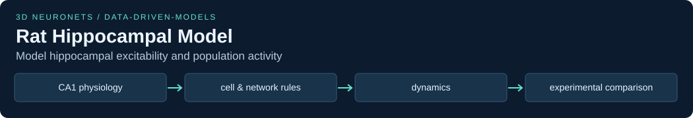

[← Portfolio](../../README.md) · [Data Driven Models](../README.md)

### From experimental recordings to computational models of hippocampal dynamics.

We develop and customize computational neuronal networks to investigate how cellular excitability, synaptic connectivity, and excitation–inhibition balance shape hippocampal activity. Combining experimental electrophysiology with large-scale simulations, our modeling approaches enable the characterization of spontaneous firing, synchronized bursting, and complex spatiotemporal patterns.

These models provide a flexible computational framework for exploring network mechanisms, testing biological hypotheses, and evaluating how changes in neuronal and synaptic properties influence emergent brain dynamics.

## Key Capabilities

Our hippocampal modeling solutions combine computational network development, experimental data integration, and advanced analysis of neuronal dynamics. We provide flexible modeling approaches tailored to specific scientific questions, from individual neuronal properties to collective network behavior.

| Capability | What We Offer |
|---|---|
| **Custom Neuronal Network Development** | Design and implementation of spiking neuronal networks with configurable neuronal populations, synaptic connectivity, and network architectures. |
| **Biophysical & Synaptic Parameterization** | Investigation of how neuronal excitability, synaptic coupling, and excitation–inhibition balance influence hippocampal network activity. |
| **Large-Scale Network Simulations** | Simulation of spontaneous neuronal firing, synchronized bursting, and transitions between distinct dynamical regimes. |
| **Network Synchronization Analysis** | Quantitative characterization of population activity through firing statistics, spike rasters, synchronization metrics, and collective dynamics. |
| **Spatiotemporal Activity Modeling** | Investigation and visualization of propagating neural waves, spatial synchronization, and complex activity patterns in spatially organized networks. |
| **Experimental Data Integration** | Comparison of simulated network dynamics with electrophysiological recordings to inform model parameterization and assess biological relevance. |

**Applications:** Hippocampal network dynamics · Synaptic connectivity · Population synchronization · Spontaneous activity · Neural wave propagation · Computational hypothesis testing

## Research applications

### Experimentally informed modeling of spontaneous hippocampal activity

Large-scale spiking neuronal networks were developed to reproduce key features of spontaneous activity observed in rat hippocampal CA1 recordings. By exploring excitation–inhibition balance, network connectivity, and population size, simulations reproduced irregular low-frequency firing and occasional bursts, demonstrating how computational models can connect experimental electrophysiology with the mechanisms underlying sustained network activity.

**Research reference:** Borges et al. (2020). *Self-sustained activity of low firing rate in balanced networks.* Physica A. [DOI](https://doi.org/10.1016/j.physa.2019.122671).

---

### Spatial hippocampal network modeling and neural wave detection

Spatially organized neuronal networks were developed to investigate how connectivity and synaptic coupling shape the propagation of neural activity. Using simulations of more than 17,000 neurons, combined with local and global synchronization analysis, the study identified spiral waves, bursting patterns, and transitions between collective dynamical states, demonstrating computational approaches for reconstructing, visualizing, and characterizing complex spatiotemporal neural activity.

**Research reference:** Souza et al. (2024). *Spiral wave dynamics in a neuronal network model.* Journal of Complexity. [DOI](https://doi.org/10.1088/2632-072X/ad42f6).

---

## Software & implementations

The research applications above establish the scientific foundation.

## Related capabilities

[Whole-Cell Patch Clamp](../../Data-Analysis/whole-cell-patch-clamp/README.md) · [Models to Study Aging](../model-to-study-aging/README.md) · [Models to Study Epilepsy](../model-to-study-epilepsy/README.md) · [In Vivo Recordings](../../Data-Analysis/in-vivo-recordings/README.md)

## Discuss your research

[Explore 3D NeuroNets](https://3dneuronets.github.io/) · [Contact us](https://3dneuronets.github.io/#contact)

*Research applications are collaborative academic contributions and demonstrate expertise; they are not represented as completed commercial contracts.*
