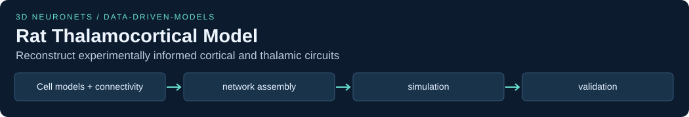
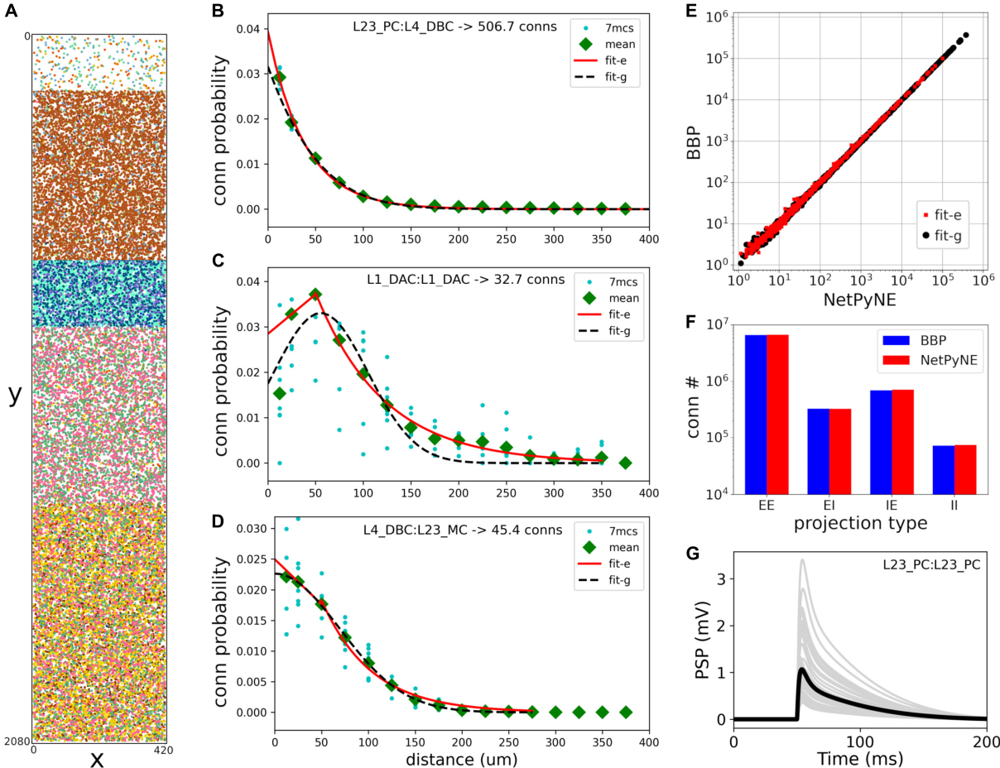

[← Portfolio](../../README.md) · [Data Driven Models](../README.md)

### From experimental neuroscience to large-scale, biophysically detailed brain simulations.

We develop and customize biologically realistic thalamocortical network models by integrating experimental data on neuronal morphology, intrinsic electrophysiology, synaptic physiology, and anatomical connectivity. Our computational approaches enable the reconstruction of complex neural circuits, from individual multicompartmental neurons to large-scale networks containing millions of synapses.

Using high-performance simulation frameworks, we provide flexible computational environments to investigate network dynamics, explore how cellular and synaptic properties influence circuit behavior, and test hypotheses that are difficult to address experimentally. These models can be adapted to specific research questions, supporting investigations of physiological activity, pathological mechanisms, and responses to external stimulation.

## Key Capabilities

Our thalamocortical modeling solutions integrate anatomical reconstruction, biophysical parameterization, large-scale simulation, and experimental validation. We develop adaptable computational frameworks that connect detailed neuronal properties with emergent circuit dynamics, providing researchers with powerful tools to explore complex neural systems.

| Capability | What We Offer |
|---|---|
| **Data-Driven Circuit Reconstruction** | Development of neuronal networks informed by experimental cell densities, morphological classifications, anatomical distributions, and connectivity measurements. |
| **Multicompartmental Neuron Modeling** | Integration and customization of detailed neuronal morphologies, ionic mechanisms, electrophysiological properties, and cell-type-specific firing dynamics. |
| **Synaptic Connectivity & Network Architecture** | Reconstruction of complex circuits using experimentally constrained connection probabilities, spatial connectivity rules, synaptic strengths, and short-term plasticity. |
| **Large-Scale Biophysical Simulations** | Development and simulation of networks with thousands of detailed neurons and millions of synapses using NetPyNE, NEURON, and high-performance computing environments. |
| **Network Dynamics & Electrophysiological Analysis** | Characterization of neuronal firing, population synchronization, oscillatory dynamics, extracellular signals, and responses to background or external inputs. |
| **Model Calibration & Experimental Validation** | Parameter exploration, optimization, and comparison of simulated neuronal and network activity with experimental electrophysiological measurements. |

**Applications:** Neural circuit reconstruction · Biophysical modeling · Experimental data integration · Synaptic connectivity · Thalamocortical dynamics · Network oscillations · High-performance simulation

---

## Research applications

### Reconstruction of Large-Scale, Data-Driven Thalamocortical Circuits

A highly detailed model of the rat somatosensory cortex was reconstructed in NetPyNE by integrating experimentally derived neuronal morphologies, electrophysiological properties, cell-type distributions, and synaptic connectivity. The cortical network incorporates **31,346 neurons, 207 morphoelectrical cell types, approximately 37 million synapses, and 1,941 connectivity pathways**, demonstrating the ability to implement and manage complex, biologically constrained neural circuits.

The reconstruction preserved key anatomical and physiological properties of the original Blue Brain Project model, including cell-specific firing behavior, distance-dependent connectivity, and synaptic dynamics. The framework was further extended with thalamic populations and experimentally informed thalamocortical connections, enabling investigations of interactions between cortical and subcortical circuits.

This work demonstrates our expertise in **transforming detailed experimental constraints into scalable computational models**, providing a foundation for model customization, parameter optimization, electrophysiological validation, and the investigation of complex network dynamics.

*Data-driven reconstruction and validation of a biophysically detailed cortical microcircuit. Spatial distribution of neuronal populations across cortical layers, reconstruction of distance-dependent synaptic connectivity, and quantitative validation of 1,941 connection pathways against the original reference model. Simulated postsynaptic responses further demonstrate the integration of synaptic physiology into the reconstructed network. Source: [Borges et al. (2022), Figure 2](https://doi.org/10.3389/fninf.2022.884245); [CC BY 4.0](https://creativecommons.org/licenses/by/4.0/). Figure cropped from supplied PDF; no data altered.*

**Research reference:** Borges et al. (2022). *Large-scale biophysically detailed model of somatosensory thalamocortical circuits in NetPyNE.* Frontiers in Neuroinformatics. [DOI](https://doi.org/10.3389/fninf.2022.884245).

## Software & implementations

| Implementation | Scope |
|---|---|
| [Thalamocortical stimulation extension](thalamocortical-stimulation/README.md) | NetPyNE model source, mechanisms, cell definitions, connection inputs, configuration and batch examples. Current injection into VPM cells is an optogenetic-like perturbation, not a field-based tACS/TMS implementation. |

The bundled code is research-stage material supplied for review. Confirm release rights and environment compatibility before publishing or reuse. No end-to-end reproduction is claimed.

## Related capabilities

[Extracellular Stimulation · tACS & TMS](../extracellular-stimulation-tacs-tms/README.md) · [Functional & Anatomical Networks](../../Data-Analysis/functional-anatomical-networks/README.md) · [Human Cortical Model](../human-cortical-model/README.md)

## Discuss your research

[Explore 3D NeuroNets](https://3dneuronets.github.io/) · [Contact us](https://3dneuronets.github.io/#contact)

*Research applications are collaborative academic contributions and demonstrate expertise; they are not represented as completed commercial contracts.*
