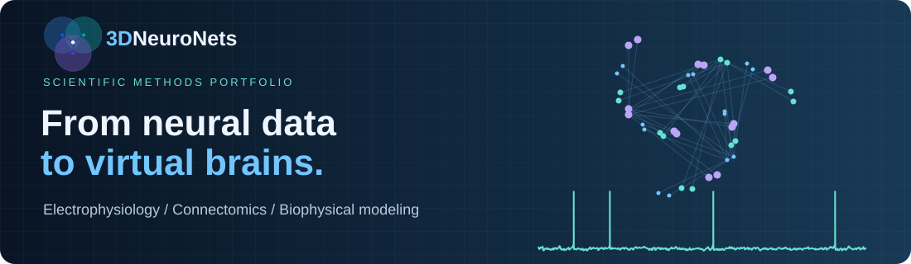

<a href="https://3dneuronets.github.io/">Website</a> · <a href="https://3dneuronets.github.io/portfolio.html">Company portfolio</a> · <a href="https://3dneuronets.github.io/publications.html">Publications</a> · <a href="https://3dneuronets.github.io/#contact">Contact</a>

# Computational Neuroscience & Data-Driven Brain Modeling

**From experimental neural data to quantitative insights and biologically informed brain simulations.**

3D NeuroNets develops tailored computational solutions for neuroscience research, combining advanced electrophysiological analysis, neural connectomics, biophysical neuronal modeling, and large-scale network simulations.

Our expertise enables researchers to extract meaningful information from complex experimental datasets, reconstruct biologically informed neural circuits, investigate cellular and network mechanisms, and explore scientific hypotheses through computational experiments.

**From standalone data-analysis projects to integrated experimental–computational studies**, we provide flexible research solutions supported by peer-reviewed publications, scientific software development, and interdisciplinary neuroscience expertise.

**Explore our capabilities in Neural Data Analysis and Data-Driven Modeling**, supported by published research, computational implementations, and interdisciplinary neuroscience expertise.

## An Integrated Approach to Computational Neuroscience

**Connecting experimental observations, computational models, and scientific discovery.**

Understanding complex neural systems requires combining information across biological scales. Our workflows integrate experimental data analysis with computational modeling, transforming neuronal measurements into quantitative descriptions, biologically constrained models, and testable predictions.

| Research Stage | Our Approach |
|---|---|
| **Experimental Data Integration** | Incorporate electrophysiological recordings, neuronal reconstructions, anatomical connectivity, and other biological measurements. |
| **Quantitative Neural Analysis** | Extract cellular properties, firing patterns, synaptic dynamics, functional interactions, and network structure. |
| **Data-Driven Model Development** | Build and customize neuronal and network models informed by experimental observations and biological constraints. |
| **Simulation & Computational Experiments** | Investigate cellular mechanisms, network dynamics, parameter variations, and responses to interventions. |
| **Validation & Scientific Interpretation** | Compare computational results with experimental measurements, refine models, and develop new research hypotheses. |

By connecting data analysis and modeling in an iterative workflow, we provide computational approaches that help bridge experimental observations and mechanistic understanding.

## Featured Focus | Human Cortical Reconstruction

**Building biologically detailed computational representations of human cortical microcircuits.**

One of our central development efforts focuses on transforming human connectomic and electrophysiological measurements into biophysically detailed neuronal network models.

Using the H01 human temporal cortex dataset as an anatomical foundation, our ongoing work integrates neuronal spatial organization, cell-type-specific connectivity, detailed neuronal morphologies, synaptic physiology, and high-performance simulation technologies.

The current human layer 2/3 implementation demonstrates a network containing **1,250 neurons across four excitatory and inhibitory populations**, developed using NetPyNE, NEURON, and CoreNEURON.

This research forms the foundation for customizable human cortical modeling solutions, enabling the investigation of cell-specific interactions, synaptic connectivity, population dynamics, and the effects of network alterations.

**Explore the complementary capabilities:**

- [Human Cortical Model](Data-Driven-Models/human-cortical-model/README.md) — Biophysical reconstruction and simulation of human cortical microcircuits.
- [Functional & Anatomical Networks](Data-Analysis/functional-anatomical-networks/README.md) — Connectomic analysis, structural organization, and reconstruction of neuronal connectivity.

## Explore Our Services

### [01 | Neural Data Analysis](Data-Analysis/README.md)

**Transform complex experimental recordings and anatomical measurements into quantitative insights.**

We develop computational workflows for processing, analyzing, and interpreting electrophysiological and connectomic datasets, supporting the characterization of cellular properties, network interactions, and neural dynamics.

| Service | Computational Solutions |
|---|---|
| [Multi-Electrode Arrays (MEA)](Data-Analysis/multi-electrode-arrays/README.md) | Multichannel neural recording analysis, spike detection, bursting activity, network synchronization, and functional connectivity. |
| [Whole-Cell Patch Clamp](Data-Analysis/whole-cell-patch-clamp/README.md) | Quantitative electrophysiological characterization of intrinsic excitability, action potentials, membrane properties, and synaptic activity. |
| [In Vivo Recordings](Data-Analysis/in-vivo-recordings/README.md) | Analysis of neural signals, oscillatory activity, event detection, and the temporal organization of neuronal population dynamics. |
| [Functional & Anatomical Networks](Data-Analysis/functional-anatomical-networks/README.md) | Reconstruction and quantitative characterization of neural connectivity from electrophysiological measurements and anatomical datasets. |

## Software catalog

| Research implementation | What it contains |
|---|---|
| [HD-MEA and aging electrophysiology](Data-Analysis/multi-electrode-arrays/hd-mea-aging-workflows/README.md) | Spike detection, transfer entropy, graph analysis and companion patch-clamp notebooks |
| [Whole-cell electrophysiology](Data-Analysis/whole-cell-patch-clamp/whole-cell-electrophysiology/README.md) | ABF feature and spontaneous-event analysis notebooks |
| [Neuronal silence](Data-Driven-Models/model-to-study-epilepsy/neuronal-silence/README.md) | C simulation, Random Forest and simulated example time series |
| [Bistable firing](Data-Driven-Models/ionic-channels-model/bistable-firing/README.md) | NetPyNE and NMODL models with parameter sweeps |
| [Thalamocortical stimulation](Data-Driven-Models/rat-thalamocortical-model/thalamocortical-stimulation/README.md) | Stimulation-oriented NetPyNE extension with cell and connectivity inputs |

Each implementation is stored once. Related capability pages link to the same source instead of duplicating it. Research implementations are distinct from supported or validated products; the supplied code is staged for release review, not yet certified as open source.

### [02 | Data-Driven Modeling](Data-Driven-Models/README.md)

**From cellular biophysics to large-scale simulations of complex brain circuits.**

We develop customizable neuronal and network models incorporating experimental anatomy, connectivity, electrophysiological properties, and synaptic mechanisms. These computational environments support mechanistic investigations, virtual experiments, and the exploration of physiological and pathological brain activity.

| Service | Computational Solutions |
|---|---|
| [Human Cortical Model](Data-Driven-Models/human-cortical-model/README.md) | H01-informed human cortical reconstruction, multicompartmental neuronal modeling, and high-performance network simulations. |
| [Rat Thalamocortical Model](Data-Driven-Models/rat-thalamocortical-model/README.md) | Large-scale reconstruction of experimentally informed cortical and thalamic circuits, including detailed cellular and synaptic physiology. |
| [Rat Hippocampal Model](Data-Driven-Models/rat-hippocampus-model/README.md) | Spiking neuronal network development, hippocampal activity modeling, synchronization analysis, and spatial neural dynamics. |
| [Models to Study Epilepsy](Data-Driven-Models/model-to-study-epilepsy/README.md) | Investigation of seizure mechanisms, pathological synchronization, predictive biomarkers, and computational intervention strategies. |
| [Models to Study Aging](Data-Driven-Models/model-to-study-aging/README.md) | Computational investigation of age-related alterations in neuronal excitability, network dynamics, and electrophysiological properties. |
| [Ionic Channel Models](Data-Driven-Models/ionic-channels-model/README.md) | Custom ionic mechanism development, conductance-based neuronal models, and systematic analysis of excitability and firing transitions. |
| [Extracellular Stimulation · tACS & TMS](Data-Driven-Models/extracellular-stimulation-tacs-tms/README.md) | Computational investigation of cellular and network responses to extracellular stimulation and neuromodulation protocols. |

## Computational Solutions & Research Deliverables

Our computational workflows are tailored to the scientific objectives, experimental datasets, and technical requirements of each project.

| Solution | Potential Deliverables |
|---|---|
| **Custom Data Analysis Workflows** | Signal-processing pipelines, electrophysiological feature extraction, statistical analyses, and publication-ready visualizations. |
| **Connectivity & Network Characterization** | Connectivity matrices, anatomical and functional network descriptions, spatial analyses, and network statistics. |
| **Biophysical Neuronal Models** | Configurable single-cell and network models incorporating neuronal morphology, ionic mechanisms, and synaptic physiology. |
| **Computational Experiments** | Simulation configurations, parameter exploration, sensitivity analyses, and quantitative characterization of network behavior. |
| **Research Software & Reproducibility** | Documented computational implementations, analysis scripts, simulation outputs, and reproducible workflows adapted to the project scope. |

Our objective is to provide scientifically grounded and adaptable computational tools that help research teams investigate complex neural systems and address specific experimental questions.

## Scientific Foundation

Our computational expertise is supported by peer-reviewed publications, collaborative scientific research, and research software development across experimental and theoretical neuroscience.

Each service page presents selected research applications, methodological capabilities, and relevant scientific references.

## Develop Your Next Neuroscience Project With Us

**Have electrophysiological recordings, connectomic datasets, or a research challenge that requires computational modeling?**

3D NeuroNets works with researchers to develop tailored computational solutions, from experimental data analysis to detailed neuronal network reconstruction and simulation.

[Explore Our Website](https://3dneuronets.github.io/) · [View Publications](https://3dneuronets.github.io/publications.html) · [Contact 3D NeuroNets](https://3dneuronets.github.io/#contact)

*Research examples include collaborative academic contributions and demonstrate relevant scientific expertise; they are not presented as completed commercial contracts.*