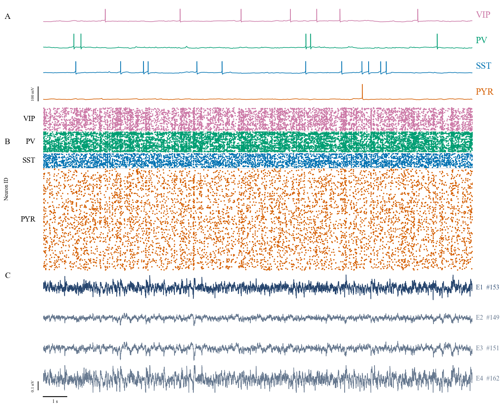
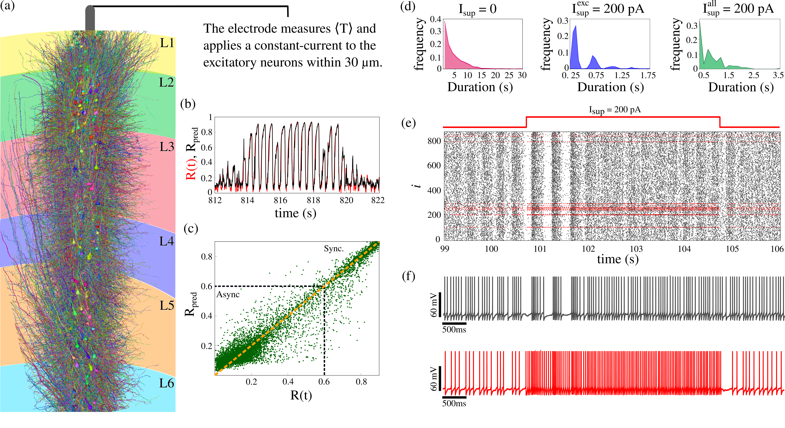
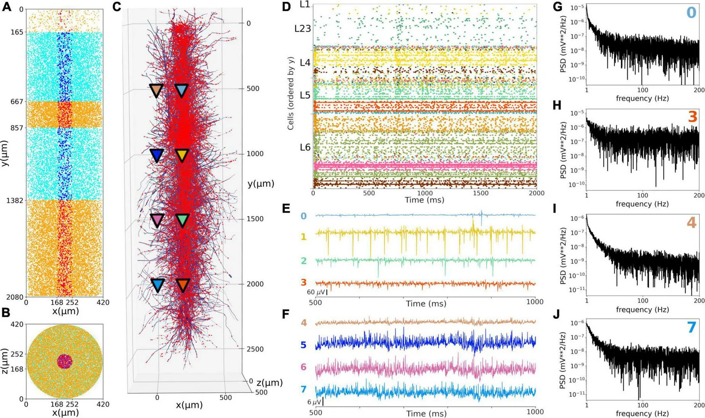

# 3D NeuroNets

### From Neural Data to Computational Models

**Neural Data Analysis | Data-Driven Brain Models | Computational Neuroscience**

[Website](https://3dneuronets.github.io/) · [Research Portfolio](#featured-research) · [Explore Our Projects](#open-source-projects)

---

## Understanding the Brain Through Data and Computational Modeling

**3D NeuroNets** specializes in computational neuroscience, combining quantitative analysis of neural recordings with biologically informed computational models to investigate the mechanisms underlying brain activity.

Our work bridges **experimental neuroscience, computational modeling, and data science**, transforming complex neural measurements into insights about neuronal function, network dynamics, and neurological disorders.

From analyzing electrophysiological recordings to developing detailed neuronal networks, we provide computational approaches to support neuroscience research and scientific collaboration.

## Our Expertise

### Neural Data Analysis

We develop and apply computational methods to investigate neural activity across different experimental scales.

Our research experience includes:

- **Electrophysiological analysis:** EEG, LFP, multielectrode array (MEA), and intracellular recordings.
- **Neural signal processing:** Spectral analysis, oscillatory activity, event detection, and spike-train characterization.
- **Functional connectivity:** Network interactions, information-theoretical approaches, and graph analysis.
- **Computational biomarkers:** Quantitative measurements associated with physiological and pathological neural dynamics.

### Data-Driven Computational Models

We develop biophysically informed computational models to investigate how cellular and network mechanisms shape brain activity.

Our modeling expertise includes:

- **Single-neuron modeling:** Intrinsic excitability, ion-channel mechanisms, and firing dynamics.
- **Neuronal network modeling:** Synaptic connectivity, population activity, and emergent network behavior.
- **Human cortical microcircuits:** Integration of anatomical, physiological, and connectomic information.
- **Brain circuit dynamics:** Cortical and thalamocortical networks, synchronization, and responses to external stimulation.

---

## Featured Research

### Human Cortical Microcircuits: From Cells to Network Activity

**Human Cortex · Connectomics · Biophysical Modeling · Electrophysiology**

How do the properties of individual neurons and their connections give rise to the collective activity of human cortical networks?

This ongoing project investigates the dynamics of human cortical layer 2/3 microcircuits using detailed neuronal models and information motivated by the H01 human connectomics dataset.

By combining neuronal morphology, synaptic interactions, and electrophysiological modeling, the project aims to connect cellular mechanisms with population-level signals, including local field potentials.

**Project status:** Ongoing research

[Explore the computational model](https://github.com/DiogoLeonai/L23-Netpyne-CoreNeuron)

---

### Neuronal Silence: Investigating Biomarkers of Epileptic Seizures

**Epilepsy · Neural Biomarkers · Network Synchronization · Machine Learning**

Can changes in neuronal activity reveal when a brain network is approaching a seizure?

This research investigates how periods of neuronal silence relate to the emergence of highly synchronized network states.

Combining computational simulations, quantitative measures of network activity, and predictive analysis, the study explores neuronal silence as a potential biomarker of epileptic seizure dynamics.

The project demonstrates how computational neuroscience can help identify measurable signatures of pathological brain activity and investigate mechanisms relevant to neurological disorders.

**Project status:** Published research · Open-source code

[Explore the research code](https://github.com/3dneuronets/Portfolio/tree/main/Data%20driven%20models/Neuronal-silence-as-an-epileptic-seizure-biomarker) · [Read the publication](https://doi.org/10.1038/s41598-026-44063-w)

---

### Thalamocortical Networks: Linking Brain Architecture and Function

**Brain Circuits · Data-Driven Modeling · Neural Dynamics · Stimulation**

How do interactions between cortical and thalamic populations shape the electrical activity of the brain?

This research uses large-scale, biophysically detailed network models to investigate neuronal activity across interconnected brain regions.

By integrating neuronal properties, synaptic connectivity, and network organization, the model provides a framework for studying the emergence of coordinated activity and the effects of external stimulation.

The project illustrates how computational models can bridge brain architecture, cellular dynamics, and electrophysiological measurements.

**Project status:** Published foundational research · Open-source implementation

[Explore the stimulation model](https://github.com/3dneuronets/Portfolio/tree/main/Data%20driven%20models/Thalamocortical_model) · [Read the publication](https://doi.org/10.3389/fninf.2022.884245)

---

## Open-Source Projects

We believe that sharing computational methods and research tools supports reproducibility, collaboration, and scientific progress.

Our portfolio brings together selected open-source implementations from published studies and ongoing research.

### Neural Data Analysis

| Project | Research Focus |
|---|---|
| [Aging and Hippocampal Dysfunction](https://github.com/3dneuronets/Portfolio/tree/main/Data%20Analysis/HD_MEA_Analysis_Aging_and_Hippocampal_Dysfunction) | High-density MEA recordings, functional connectivity, transfer entropy, and hippocampal electrophysiology |
| [Whole-Cell Patch-Clamp Analysis](https://github.com/3dneuronets/Portfolio/tree/main/Data%20Analysis/Whole-Cell-Patch-Clamp-Analysis) | Intrinsic neuronal properties, action potential characterization, and synaptic event analysis |

### Data-Driven Models

| Project | Research Focus |
|---|---|
| [Human Cortical L2/3 Network](https://github.com/DiogoLeonai/L23-Netpyne-CoreNeuron) | Human cortical microcircuits and network electrophysiology |
| [Neuronal Silence and Epilepsy](https://github.com/3dneuronets/Portfolio/tree/main/Data%20driven%20models/Neuronal-silence-as-an-epileptic-seizure-biomarker) | Epileptic network dynamics and computational biomarkers |
| [Thalamocortical Circuit Stimulation](https://github.com/3dneuronets/Portfolio/tree/main/Data%20driven%20models/Thalamocortical_model) | Large-scale neuronal network modeling and stimulation |
| [Potassium and Calcium Currents in Bistability](https://github.com/3dneuronets/Portfolio/tree/main/Data%20driven%20models/The-Roles-of-Potassium-and-calcium-currents-in-the-bistable-firing-transition) | Ionic mechanisms, neuronal excitability, and firing-state transitions |

*The portfolio is continuously evolving. Additional research implementations, analysis workflows, and computational models will be made available as projects are prepared for public release.*

---

## Research and Collaboration

At 3D NeuroNets, we are interested in connecting experimental observations with computational approaches to better understand neural systems.

Our expertise spans neural data analysis, neuronal and network modeling, computational biomarkers, and the interpretation of electrophysiological signals.

We welcome opportunities for scientific collaboration and interdisciplinary research.

**Interested in exploring how computational neuroscience can support your research?**

Visit our [website](https://3dneuronets.github.io/) to learn more about 3D NeuroNets and get in touch.

---

*3D NeuroNets — Where Neural Data and Models Converge.*

